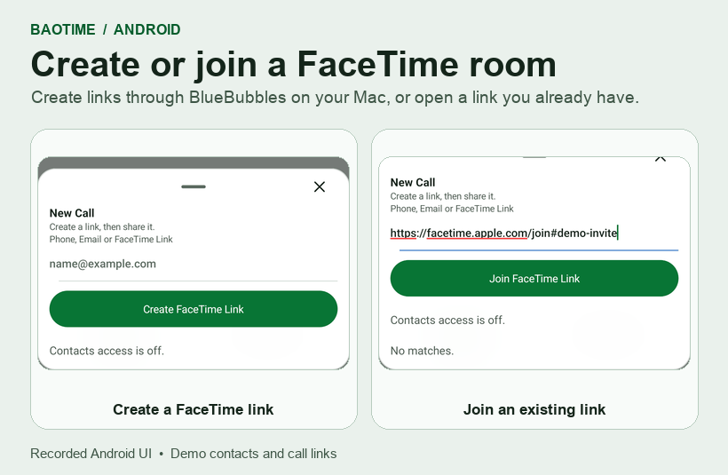
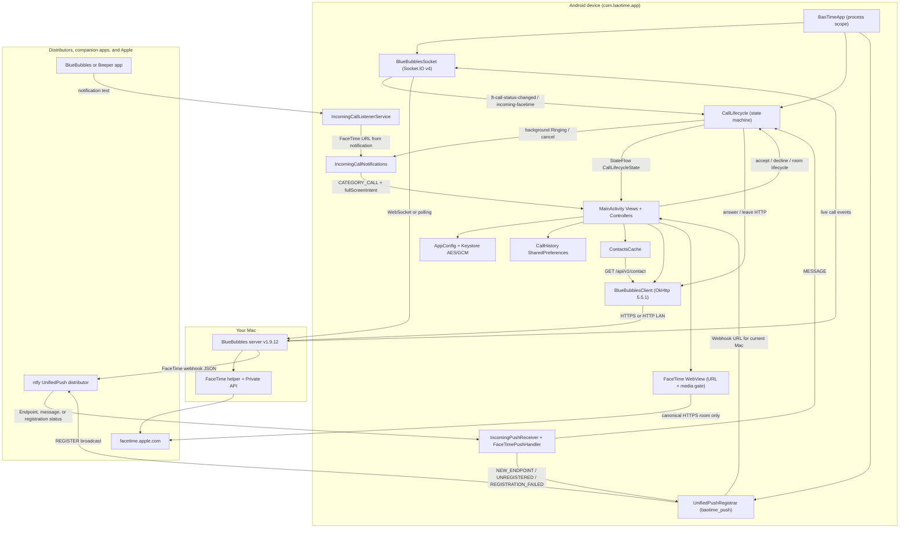
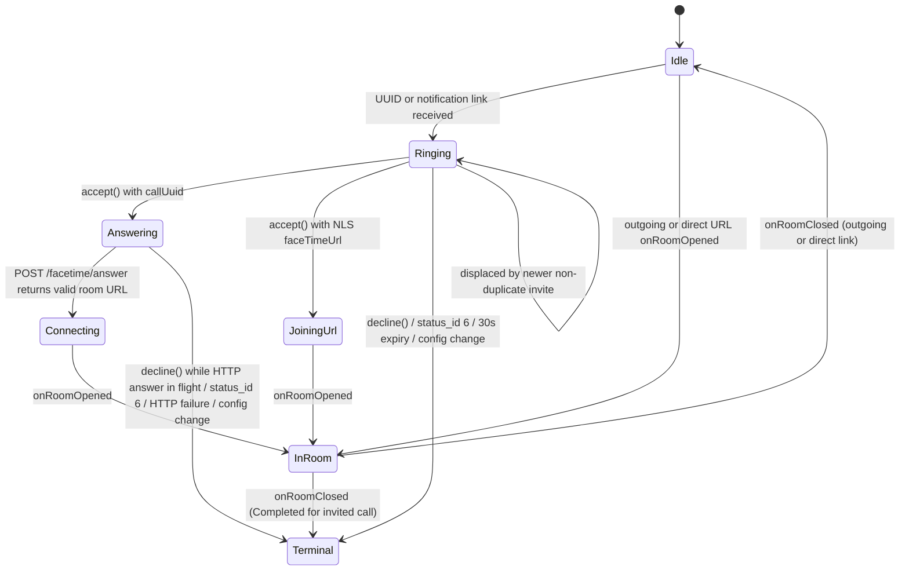
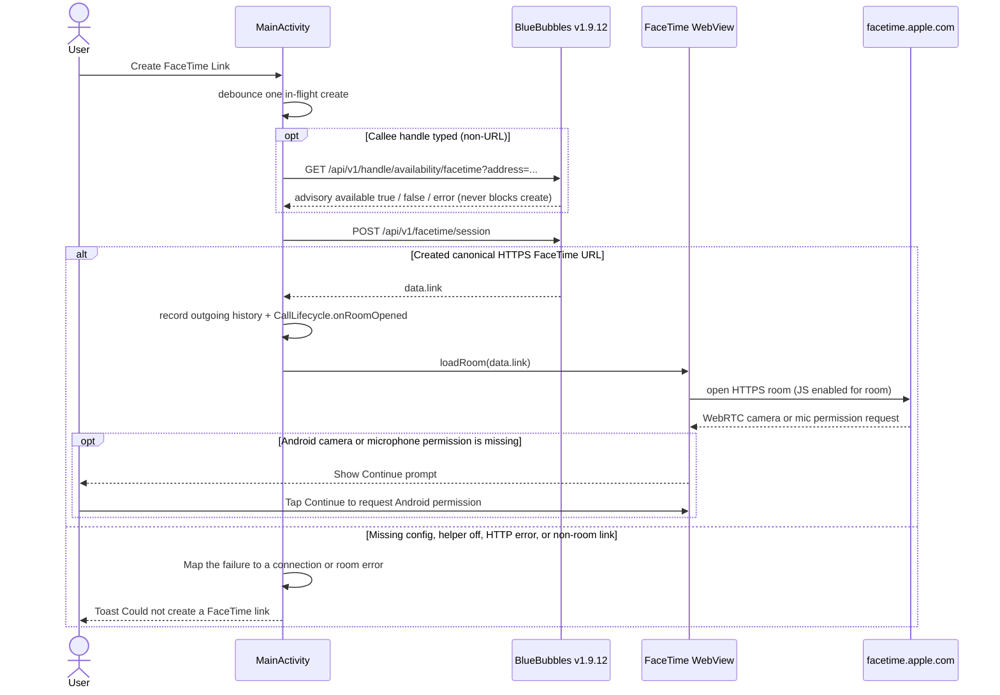
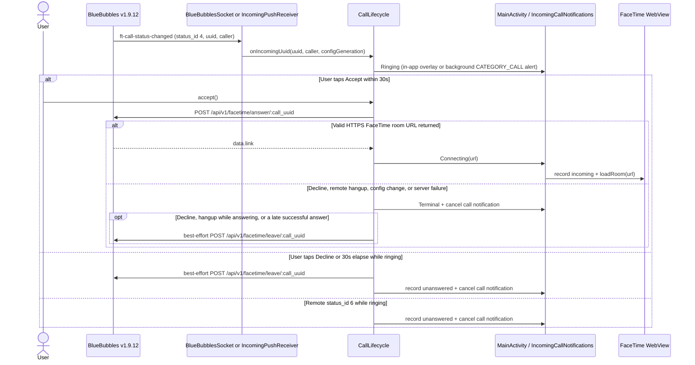
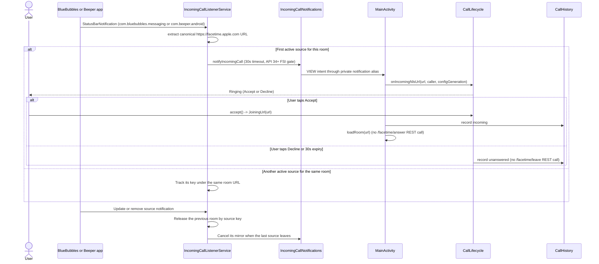
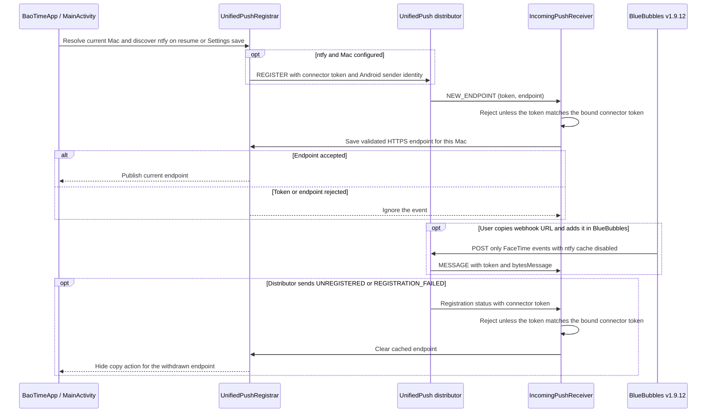
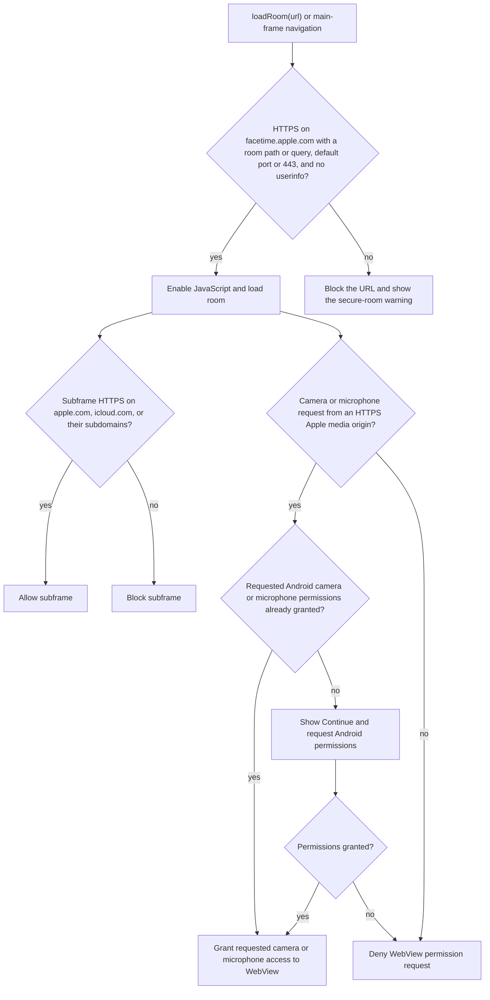

# BaoTime

[](#build-and-install)
[](#build-and-install)
[](#build-and-install)
[](#build-and-install)
[](#build-and-install)
[](#build-and-install)
[](#code-map)
[](#architecture)
[](#architecture)
[](#incoming-call-delivery)

<p align="center">
  
</p>

BaoTime is an Android app for joining FaceTime web rooms, creating shareable links through a Mac running BlueBubbles, and answering incoming invitations. It runs on Android 10 or later. You can join an existing link without a Mac connection.

<details open>
<summary>Android feature walkthrough</summary>

[](assets/baotime-screens.gif)

[Open the animated GIF](assets/baotime-screens.gif)

</details>

## ELI5

- **Got a FaceTime link?** Open it in BaoTime on your Android phone. You can join without setting up a Mac.
- **Want to start a call?** BaoTime asks BlueBubbles on your Mac for a FaceTime link. Share the link with the person you want to call, and you can meet in the same room.
- **Getting a call on your Mac?** BaoTime can show an invitation on your phone. Tap **Accept** to open the room. Enable BaoTime notifications to see alerts while the app is in the background.

## Use BaoTime

- **Join a room.** Open **New Call**, paste the full `https://facetime.apple.com/…` link, and tap **Join FaceTime Link**. In the room, tap **Continue** when prompted for camera and microphone access. The host may need to admit you.
- **Create a link.** Tap **Create FaceTime Link** in **New Call** or from a contact. The phone number or Apple ID field is optional. BaoTime opens the room after BlueBubbles creates the link. Use **Share** in **Room options** to invite the other person. Anyone with the link can ask to join.
- **Answer an invitation.** Tap an incoming call alert, then choose **Accept** or **Decline**. BaoTime asks your Mac to answer a live FaceTime call and opens the returned web room. For a notification containing a FaceTime link, it opens that link directly.
- **Find people and past calls.** **Contacts** searches favorites, Mac contacts synced through BlueBubbles, and Android contacts. Use **Dial With Phone App** from a phone-number contact for a cellular call. **Recents** stores local history with options to rejoin, copy, share, or delete links.

<a name="limitations"></a>

BaoTime opens one room at a time in an embedded Android WebView and offers picture-in-picture. If the room fails to load or media access fails, copy the link and open it in the latest Chrome or Edge, the browsers Apple documents for FaceTime on Android. [Apple’s FaceTime web guide](https://support.apple.com/en-us/109364)

Local emulator audits verify native UI, closed/unavailable Apple room screens, and Apple’s Terms modal inside the gated WebView; live two-way Apple-host FaceTime room admission and audio/video verification require an external Apple host and remain **`NOT RUN`** / externally blocked here.

## Connect to your Mac

1. Run BlueBubbles Server **1.9.12** on a Mac signed in to FaceTime. Creating and answering calls through the server requires **Private API** enabled and the FaceTime helper connected. [Server 1.9.12](https://github.com/BlueBubblesApp/bluebubbles-server/releases/tag/v1.9.12) · [Private API setup](https://docs.bluebubbles.app/private-api/installation)
2. In BaoTime, go to **Settings → Mac Connection**. Enter the server's base URL and BlueBubbles password in their separate fields, then tap **Save Connection**. Prefer HTTPS. BaoTime stores the password encrypted using Android Keystore.
3. Check the connection status under the main screen title. **Saved · Mac unavailable** in Settings means the settings were saved but the connection check failed. Verify the phone can reach the Mac and check the server address and password. If the Mac is reachable and link creation still fails, check the version and helper status.
4. Optionally use **Settings → FaceTime Links** to choose BaoTime in Android’s link settings, if Android offers it. To use the device address book, grant BaoTime **Contacts** access in Android’s app settings.

### Incoming call delivery

| Source | Setup and behavior |
| --- | --- |
| Live BlueBubbles connection | Works while BaoTime’s process is running and connected to the Mac. |
| BlueBubbles webhook through ntfy | Configure the FaceTime events in BlueBubbles Webhooks using the URL BaoTime creates through ntfy. |
| BlueBubbles or Beeper notifications | In **Settings → Incoming Invitations**, grant notification access. BaoTime can surface an invitation when one of those apps posts a notification containing a FaceTime link. |

Open BaoTime **Settings → Call alerts** to allow or manage background call alerts. **Incoming Invitations** opens Android’s separate listener access setting for BlueBubbles and Beeper notifications. If you force-stop BaoTime, reopen it to resume delivery. [Android’s stopped-state behavior](https://developer.android.com/about/versions/15/behavior-changes-all#enhanced-stop-states)

BaoTime generates and stores a connector token before contacting a UnifiedPush distributor. Each `MESSAGE`, `NEW_ENDPOINT`, `UNREGISTERED`, and `REGISTRATION_FAILED` broadcast must include that exact token. The receiver ignores delivery before a token exists.

For webhook delivery, install and open [ntfy for Android](https://docs.ntfy.sh/subscribe/phone/), enable UnifiedPush in ntfy, and choose an HTTPS ntfy server you trust with caller information. Enable FaceTime calling in BlueBubbles and save the Mac connection in BaoTime. Open **Settings → Background invitations → Copy webhook URL**. Add the copied URL in **BlueBubbles → Webhooks**, selecting only **FaceTime Call Status Changed (Experimental)**. Keep the URL private. The copied URL disables ntfy message caching, so a disconnected distributor can miss an invitation. After changing to another Mac, copy its new URL and remove the old webhook from the previous Mac. A password change at the same server address keeps the existing URL. [BlueBubbles webhook setup](https://docs.bluebubbles.app/client/usage-guides/using-unified-push-for-notifications) · [ntfy UnifiedPush publishing](https://docs.ntfy.sh/publish/#unifiedpush)

## Build and install

Install the **Android 17 SDK** (`platforms;android-37.0`) and Android SDK Platform-Tools. Set `ANDROID_HOME` or let Android Studio create `local.properties` with `sdk.dir`. [Android 17 SDK setup](https://developer.android.com/about/versions/17/setup-sdk)

The project pins Gradle **9.9.1**, Android Gradle Plugin **9.5.1**, and a Gradle daemon running on **JDK 25**. The wrapper needs a local Java installation to start and can provision the daemon JDK. [AGP release notes](https://developer.android.com/build/releases/agp-9-5-0-release-notes) · [Gradle daemon guide](https://docs.gradle.org/9.9.1/userguide/gradle_daemon.html)

From the repository root, with an emulator or a device with USB debugging enabled:

```sh
./gradlew :app:assembleDebug
adb install -r app/build/outputs/apk/debug/app-debug.apk
```

The app appears as **BaoTime** in the launcher. The Android package is `com.baotime.app`. On Windows, use `gradlew.bat`.

## Verify changes

```sh
./gradlew :app:test :app:assembleDebug :app:assembleDebugAndroidTest :app:lintDebug
python3 scripts/audit_design.py
python3 -m unittest discover -s scripts -p 'test_*.py'
```

The Gradle command runs JVM tests, builds the app and instrumentation APKs, and runs Android Lint. The Python audit checks design source and icon provenance.

To audit the FaceTime WebView, install the current debug APK and open a synthetic test room on a dedicated emulator. Use a link and displayed data safe to retain in raw scan results and screenshots. With Node.js 22 or later and `adb` on your PATH, run the following from the repository root. Substitute your emulator serial for `emulator-5554` and use a unique run ID for each scan.

```sh
npm --prefix scripts/axe ci --ignore-scripts
node --test scripts/axe/run.test.mjs
npm --prefix scripts/axe run audit -- emulator-5554 room-default
npm --prefix scripts/axe run audit -- emulator-5554 room-full-catalog full-catalog
```

Both scans save complete results under `build/reports/axe/` and exit with code 1 on violations. They verify the installed build, document and rule inventory. The full-catalog scan includes experimental rules. Review incomplete results manually. Room-page coverage alone does not verify admission or media. [axe-core 4.14.0 API](https://github.com/dequelabs/axe-core/blob/v4.14.0/doc/API.md)

Create a disposable Android 15 (API 35) emulator named `baotime_audit_20261107` in Android Studio's Device Manager. Keep personal data off this emulator. The native journeys change BaoTime permissions, insert and remove synthetic contacts, and exercise Android appearance settings. Reset the app fixture before each native run.

```sh
adb -s emulator-5554 install -r app/build/outputs/apk/debug/app-debug.apk
adb -s emulator-5554 install -r app/build/outputs/apk/androidTest/debug/app-debug-androidTest.apk
adb -s emulator-5554 shell pm clear com.baotime.app
python3 scripts/audit_device.py emulator-5554 native-audit native
python3 scripts/audit_device.py emulator-5554 launcher-audit launcher
```

The device gate saves the raw AndroidJUnitRunner output and APK identity in `build/reports/device/`. It verifies both installed APKs, requires a successful result from each named test, and rejects incomplete or skipped runs even when `adb` exits zero.

For [instrumented tests](app/src/androidTest/java/com/baotime/app/), select tests and runner arguments for the device you’re using.

| Tests | Requirements |
| --- | --- |
| Native journeys, contacts, history, credential storage, and room UI | API 35 AVD named `baotime_audit_20261107`, `auditFixture=true`, and an `evidenceRun` of lowercase letters, digits, or hyphens |
| `InstalledLauncherTest` | `installationCheck=true` and `evidenceRun` |
| `DeviceConnectionCheckTest` | Xiaomi deployment device, `deploymentCheck=true`, and `expectedServer` matching the Tailscale HTTPS URL in the local `filesDir/deployment-connection-input.json` fixture (**`NOT RUN`** in local emulator audits without that hardware) |

### Verification status

The local audit on 2026-11-17 passed 72 JVM tests, 59 native journeys, the launcher check, 17 Python regression tests, 16 axe runner regression tests, and 693 design checks.

- **WebView accessibility** — Both axe scans reported zero violations on the unavailable-room screen. The full-catalog scan flagged one Apple-rendered hidden button for manual review. [axe hidden-content rule](https://dequeuniversity.com/rules/axe/4.14/hidden-content)
- **Emulator visuals** — Android status icons appeared clipped in the isolated API 35 room captures. The cause remains unverified.
- **Live FaceTime** — Apple-host room admission and two-way audio and video remain **NOT RUN**. A live test needs an Apple host and an Android participant.
- **Deployment** — The Xiaomi and Tailscale connection check remains **NOT RUN** in the emulator audit. It needs the deployment device and a reachable configured Mac.
- **Source audit coverage** — Kotlin and Gradle inputs, including the wrapper JAR, are outside the remote scanner's coverage. The Android build, lint, JVM and native checks provide separate evidence for those surfaces.
- **Android Lint** — The UnifiedPush receiver retains the `ExportedReceiver` warning. It receives distributor broadcasts and checks the current connector token before accepting a callback.
- **Project license** — BaoTime's project license is unspecified. The [third-party notices](NOTICE) document upstream components.

## Architecture

### System overview



### CallLifecycle state machine

`BaoTimeApp` owns one `CallLifecycle` for the app process. It deduplicates Socket.IO and UnifiedPush events by call UUID and uses connection and invitation generations to discard stale results. Notification-listener invitations carry a room URL and can open it directly.



## Call flows

### Create a link, then join



### Incoming BlueBubbles Socket.IO or UnifiedPush call (UUID)



### Incoming BlueBubbles or Beeper notification fallback (URL-only)



### UnifiedPush discovery and endpoint registration



### Room URL and media gate



## Code map

| Area | Where to look |
| --- | --- |
| Android entry point and activity lifecycle | [MainActivity](app/src/main/java/com/baotime/app/MainActivity.kt) |
| Outgoing calls, join/open link actions | [CallLinkController](app/src/main/java/com/baotime/app/call/CallLinkController.kt) |
| Tab selection, history and contacts rendering | [MainTabsController](app/src/main/java/com/baotime/app/ui/MainTabsController.kt) |
| Call session, media consent, and PiP | [CallSessionController](app/src/main/java/com/baotime/app/call/CallSessionController.kt) |
| Incoming call state shared by socket, push, and notification handling | [CallLifecycle](app/src/main/java/com/baotime/app/call/CallLifecycle.kt) |
| Incoming invite intake (socket UUID, NLS URL, legacy) | [InviteIntake](app/src/main/java/com/baotime/app/call/InviteIntake.kt) |
| BlueBubbles requests and server requirements | [BlueBubblesClient](app/src/main/java/com/baotime/app/network/BlueBubblesClient.kt) and [ServerCapability](app/src/main/java/com/baotime/app/network/ServerCapability.kt) |
| Web room navigation and media permissions | [FaceTimeWebViewHelper](app/src/main/java/com/baotime/app/ui/FaceTimeWebViewHelper.kt) |
| Build settings and dependency pins | [App build configuration](app/build.gradle.kts) and [Android Gradle plugin pin](build.gradle.kts) |

<a name="documentation-index"></a>

See [NOTICE](NOTICE) for third-party dependency notices.

