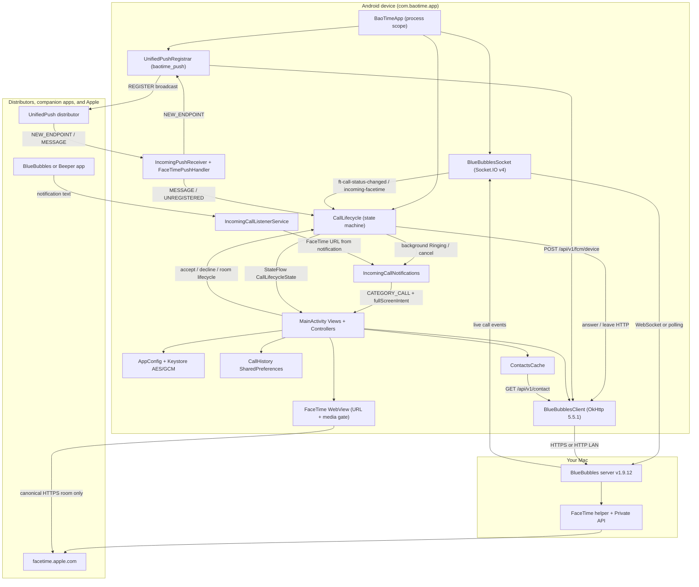
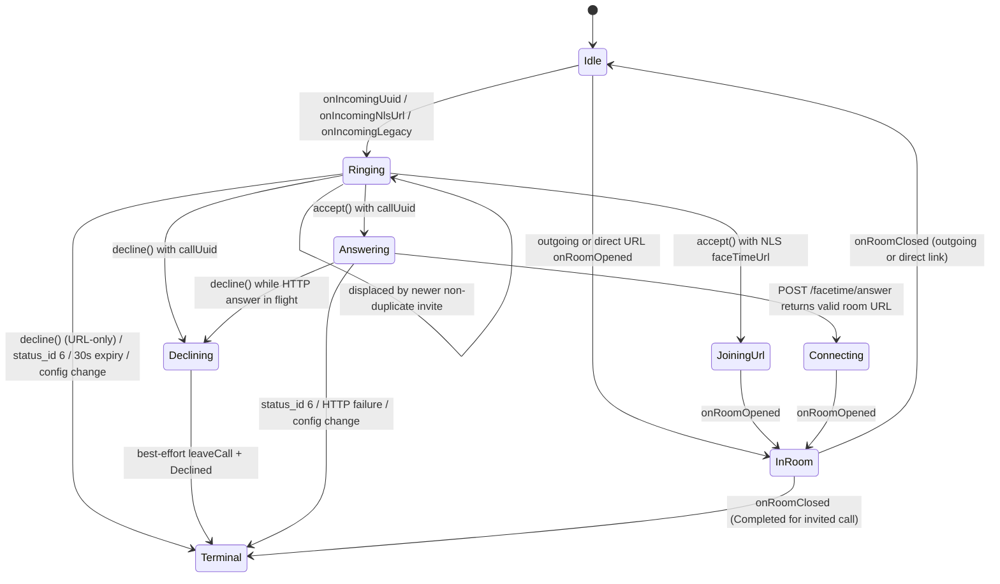
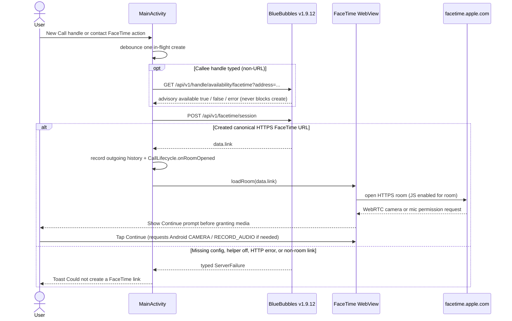
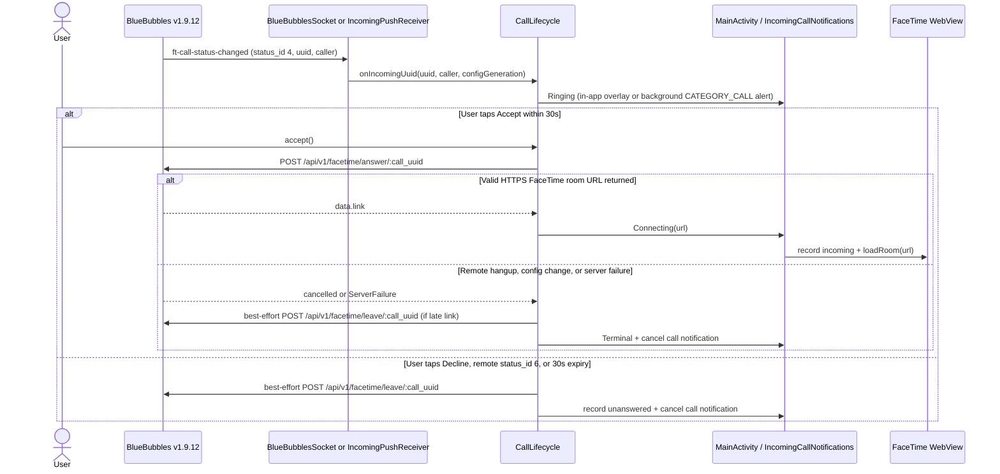
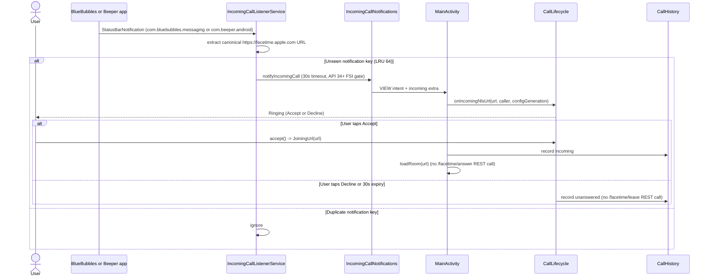
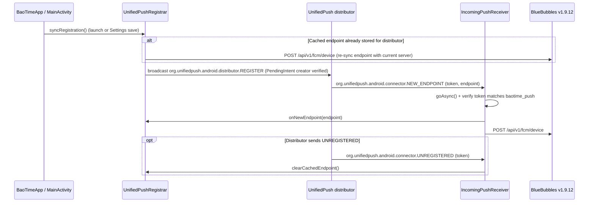
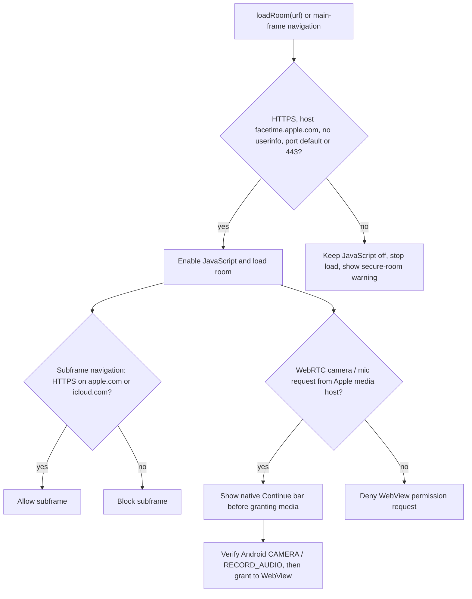

# BaoTime

[](#build)
[](#requirements)
[](#requirements)
[](#build)
[](#build)
[](#build)
[](#repository-layout)
[](#architecture)
[](#architecture)
[](#incoming-invitations)
[](#limitations)

<p align="center">
  
</p>

## ELI5

Explain it like I'm 5:

- **Android phones do not have Apple's FaceTime app built in** — only Apple devices can start or answer real FaceTime calls directly with Apple.
- **Your Mac stays at home and does the Apple part.** It runs a free helper server called [BlueBubbles](https://bluebubbles.app/) that knows how to create and answer FaceTime web links on your Mac.
- **Starting a call:** You pick a contact (or type a phone number or email) in BaoTime. BaoTime asks your Mac *"make me a FaceTime room link,"* opens that link inside a locked-down mini browser right inside BaoTime, and lets you share the link and talk on video.
- **Answering a call:** When someone FaceTimes your Mac, your Mac rings BaoTime on your Android phone (over a live connection, UnifiedPush, or a companion notification). Your phone wakes up and shows a native **Accept / Decline** call screen instead of making you dig through chat messages for a web link.
- **What BaoTime is NOT:** It is **not** made by Apple, it is **not** an iMessage chat app, and it does **not** replace your regular cellular Phone app (normal phone calls are handed to your phone's built-in dialer).

## Contents

- [ELI5](#eli5)
- [What it is](#what-it-is)
- [Documentation index](#documentation-index)
- [Features](#features)
- [Architecture](#architecture)
- [Call flows](#call-flows)
- [Requirements](#requirements)
- [First-run setup](#first-run-setup)
- [Build](#build)
- [Tests](#tests)
- [Icons and design audit](#icons-and-design-audit)
- [Repository layout](#repository-layout)
- [Security and data](#security-and-data)
- [Limitations](#limitations)
- [Verification status](#verification-status)

## What it is

BaoTime (`com.baotime.app`, version **1.1.0** / `versionCode` 2) is a single-module Android app written in Kotlin with the Android View system (no Jetpack Compose, no Material Components library). `MainActivity` owns Recents, Contacts, Settings sheets, incoming invitations, and one FaceTime room at a time.

The Mac side is out of this tree. BaoTime is the Android client: it stores your BlueBubbles base URL and password, talks to BlueBubbles v1.9.12 over OkHttp 5.5.1 and a process-wide Socket.IO 4 connection (`BlueBubblesSocket` + `CallLifecycle` owned by `BaoTimeApp`), opens `https://facetime.apple.com/...` rooms, and cooperates with BlueBubbles / Beeper notifications plus Android's link and dial intents.

This GitHub repository is **private**. Third-party dependency notices are recorded in [`NOTICE`](NOTICE); there is **no GitHub Actions workflow**. Badges above are static shields, not CI status.

## Documentation index

In-tree work-package docs:

| Doc | What it is |
| --- | --- |
| [`tasks/README.md`](tasks/README.md) | Index of the work packages |
| [`tasks/plan.md`](tasks/plan.md) | Source-backed BlueBubbles FaceTime ingest plan (pins, licence, call lifecycle, FGS/push, WebView risk) |
| [`tasks/todo.md`](tasks/todo.md) | Dependency-ordered tasks with acceptance and verification |
| [`tasks/audit-resolution.md`](tasks/audit-resolution.md) | Code Auditor finding → resolution → location |
| [`NOTICE`](NOTICE) | Third-party dependency licence and provenance inventory |

**Authoritative workstream planning:** see [BaoTime workstream adoption](tasks/workstreams/README.md). The frozen accepted overlay governs workstream planning where baseline text conflicts; the baseline technical constraints remain subject to its precise supersession map. This is not an implementation or test-completion claim.

Those planning files are **not** a certified legal clean-room.

## Features

Grounded in `app/src/main` (manifest, strings, and Kotlin). Things the app does **not** do are listed under [Limitations](#limitations).

### Recents

- Newest-first history of FaceTime links BaoTime opened, received, or declined.
- Row action joins a stored link, or creates a new one when no URL is stored.
- Opening a row shows copy, share, join, and delete.
- Header action clears all history after a confirmation sheet.
- Unanswered invitations increment a Recents tab badge.
- UI shows up to **40** rows; the store keeps at most **100**.

### Contacts

- Search across favorites, iMessage contacts from the Mac (`GET /api/v1/contact`), and this device's address book.
- Mac contacts skip addresses already present on the device.
- Contact sheet: create a FaceTime link, dial a phone number with the system Phone app (not for email/Apple ID), add or remove a favorite.
- Denied device-contacts access sends you to app settings (there is **no** in-app runtime `READ_CONTACTS` dialog).
- First 30 rows per section, then "Show all".

### New Call

- Sheet for a phone number, Apple ID / email, or a whole `https://facetime.apple.com/...` URL.
- Whole FaceTime URL → join that room. Anything else → ask BlueBubbles to mint a new session, then open it.
- Matching contacts appear under the field as you type.

### FaceTime room

- One WebView overlay. JavaScript is **off** until the URL is a canonical HTTPS FaceTime room (`facetime.apple.com`, no userinfo, port 443 or default). Apple’s own FaceTime-on-the-web article names **Chrome or Edge** on Android, not WebView — see [Limitations](#limitations).
- Main-frame navigation must stay on those rooms. Subframes must be HTTPS on `apple.com` / `icloud.com` hosts (lookalikes rejected).
- Camera and microphone: Apple's page requests them; BaoTime shows **Continue** only after that, then asks Android for `CAMERA` / `RECORD_AUDIO` if needed. Declining an incoming invitation never starts media.
- Picture-in-picture (9:16). Auto-enter on Android 12+ only while this overlay is the top surface and resumed.
- Room menu: share the link, speaker (Android 12+ communication device), PiP, reload. Closing the overlay records elapsed session time.

### Incoming invitations

- **Live Socket.IO 4 (`BlueBubblesSocket`, process-wide in `BaoTimeApp`):** subscribes to `ft-call-status-changed` (`status_id == 4` incoming with `uuid`, `status_id == 6` disconnected) and legacy `incoming-facetime` while the app process is alive, automatically recovering `Offline` sockets when `MainActivity` resumes. When foregrounded, `MainActivity` presents the native `IncomingCallUi` directly; when backgrounded with no `STARTED` Activity, `BaoTimeApp` posts a `NotificationCompat.CATEGORY_CALL` alert (`IncomingCallNotifications`) with a 30s timeout and lockscreen wake (`setShowWhenLocked` / `setTurnScreenOn`). Accepting a `uuid`-backed call invokes `POST /api/v1/facetime/answer/:call_uuid` (cancellable if declined, hung up, or invalidated by a Settings save) and opens the returned room link in the gated WebView. Declining or timing out (30s) invokes best-effort `POST /api/v1/facetime/leave/:call_uuid`, cancels active call notifications, and records an unanswered Recents row.
- **Clean-room UnifiedPush / push ingress (`UnifiedPushRegistrar` + `IncomingPushReceiver` + `FaceTimePushHandler`):** actively discovers an installed UnifiedPush distributor (`org.unifiedpush.android.distributor.REGISTER` with `PendingIntent` creator verification), persists the connector token and delivered endpoint in `baotime_push` (re-registering automatically when BlueBubbles credentials are saved), handles `org.unifiedpush.android.connector.NEW_ENDPOINT` under `goAsync()` (`POST /api/v1/fcm/device`), clears stale endpoints on `UNREGISTERED`, and routes `org.unifiedpush.android.connector.MESSAGE` (`ft-call-status-changed` and `incoming-facetime` payloads) into the same `CallLifecycle` (`InviteSource.Fcm`) and `POST /api/v1/facetime/answer/:call_uuid` path. When the user force-stops BaoTime in Android Settings (`stopped=true`), Android blocks broadcasts until the user manually reopens BaoTime once.
- **Notification Listener fallback (`IncomingCallListenerService`):** watches **BlueBubbles** (`com.bluebubbles.messaging`) and **Beeper** (`com.beeper.android`) only. If notification text contains a FaceTime URL, BaoTime posts a high-importance call notification (`R.drawable.ic_video_call` monochrome status icon, 30s timeout, API 34+ `NotificationManager.canUseFullScreenIntent()` gate). NLS URL-only invitations and socket/push UUID invitations are tracked as separate identities in `CallLifecycle`. Duplicate notification keys (up to 64) and duplicate UUIDs are ignored.

### Settings

- Mac connection: server address + BlueBubbles password. Password is AES/GCM-encrypted in Android Keystore (`v1:` envelope). Save is allowed while the Mac is offline; connectivity is a later status.
- FaceTime Links: whether Android selected BaoTime as the `facetime.apple.com` handler (readable on Android 12+).
- Incoming Invitations: notification listener access plus whether app notifications are enabled.
- Settings gear tints green when `GET /api/v1/server/info` succeeds (version, private API, helper, detected iMessage handle all present).

### System intents

`MainActivity` is `singleTask`, exported, and handles:

| Intent | What BaoTime does |
| --- | --- |
| `https://facetime.apple.com` / `/join` (`autoVerify`) | Join that web room (or show the incoming surface when the extra says it is an incoming call) |
| `facetime:` / `facetime-audio:` | Prefill New Call with the handle |
| `tel:` / `ACTION_DIAL` | Prefill New Call with the number |
| `ACTION_SEND` `text/plain` | Join if the shared text **is** a FaceTime URL; otherwise prefill New Call |

## Architecture

### System overview



### Authoritative `CallLifecycle` state machine

`CallLifecycle` (`BaoTimeApp`) owns a single process-wide state store keyed by `callUuid`, `configGeneration` (`AppConfig.connectionRevision`), and `inviteGeneration`. Same-UUID events from Socket.IO and UnifiedPush collapse to one invite; URL-only Notification Listener invites (`InviteSource.NlsUrl`) stay strictly separate and never call `/facetime/answer` or `/facetime/leave`.



Package map (all under `com.baotime.app`):

| Package | Role |
| --- | --- |
| `(root)` | `BaoTimeApp` process-scoped signaling/push owner + `MainActivity` single-task UI scaffold & lockscreen call presentation |
| `config` | SharedPreferences connection + favorites; Keystore AES/GCM password; appearance gates |
| `network` | OkHttp 5 transport, `BlueBubblesClient`, `BlueBubblesSocket` (Socket.IO v4), `ServerCapability`, `FaceTimePushHandler`, `LogRedactor`, URL shape policy |
| `routing` | Intent → action; FaceTime URL classification; canonical BlueBubbles API routes |
| `data` | History codec; device contacts provider; Mac + device contacts cache |
| `call` | `CallLifecycle` state machine, `UnifiedPushRegistrar`, `IncomingPushReceiver`, `IncomingCallListenerService`, `IncomingCallNotifications`, room & incoming controllers |
| `audio` | Speaker as a communication device (API 31+). Does not set mode or mute |
| `system` | Domain verification, API 34+ full-screen intent gate, and system settings jumps |
| `ui` / `ui.theme` / `ui.components` | View chrome, glass blur, modal sheets, incoming overlay, gated WebView room |

BlueBubbles paths the client actually calls:

| Method | Path | Use |
| --- | --- | --- |
| `GET` | `/api/v1/ping` | Socket auth verification (`200 pong` vs `401` unauthorized) |
| `GET` | `/api/v1/server/info` | Reachability & capability gate (`server_version == "1.9.12"`, `private_api`, `helper_connected`, `detected_imessage`) |
| `POST` | `/api/v1/facetime/session` | Mint a generic FaceTime link (`{}` body) |
| `POST` | `/api/v1/facetime/answer/:call_uuid` | Answer an incoming FaceTime call UUID and return its web link (`{}` body) |
| `POST` | `/api/v1/facetime/leave/:call_uuid` | Best-effort leave for an incoming FaceTime call UUID (`{}` body) |
| `GET` | `/api/v1/handle/availability/facetime?address=` | Non-blocking advisory check before generic link creation |
| `POST` | `/api/v1/fcm/device` | Register a push token or UnifiedPush endpoint with BlueBubbles |
| `GET` | `/api/v1/contact` | Mac address book |

The password is sent as a `password` **query parameter** on HTTP URLs and `guid` on the Socket.IO handshake (BlueBubbles v1), scrubbed from diagnostic URLs via `LogRedactor`. Timeouts: connect 6s, read 25s (45s for `/facetime/answer/:call_uuid`).

## Call flows

### Create a link, then join



### Incoming BlueBubbles Socket.IO or UnifiedPush call (UUID)



### Incoming BlueBubbles or Beeper notification fallback (URL-only)



### UnifiedPush discovery & endpoint registration



### Room URL & media gate



## Requirements

### Runtime (the phone)

- Android **10** (API 29) or later. `targetSdk` / `compileSdk` **37**.
- A reachable BlueBubbles server that can mint FaceTime sessions. The in-app copy talks about the FaceTime helper; the optional Xiaomi deployment test also asserts **Private API** and **helper connected**.
- Network. HTTP is allowed (`android:usesCleartextTraffic="true"`) because LAN / `.local` / Tailscale CGNAT URLs are accepted by `ServerUrlPolicy`.
- Optional: BlueBubbles or Beeper installed for incoming notification capture; notification listener + (on API 33+) `POST_NOTIFICATIONS`.
- Optional: `READ_CONTACTS` granted from system settings for on-device names.
- Optional: user-selected default handler for `facetime.apple.com` (Android 12+). This tree has **no** Digital Asset Links file, so Play / domain auto-verify is not something the repo itself completes.

### Build machine

| Piece | What the tree pins |
| --- | --- |
| Gradle | Wrapper **9.9.0** ([`gradle/wrapper/gradle-wrapper.properties`](gradle/wrapper/gradle-wrapper.properties)) |
| Android Gradle Plugin | **9.6.0-alpha03** (preview) via [`gradle/libs.versions.toml`](gradle/libs.versions.toml) |
| Kotlin | Sources are `.kt`; `app/build.gradle.kts` applies `com.android.application` with AGP 9 built-in Kotlin support (no separate Kotlin Gradle plugin pin). |
| Java bytecode | Source / target **17** |
| Gradle daemon JVM | Toolchain **25** via [`gradle/gradle-daemon-jvm.properties`](gradle/gradle-daemon-jvm.properties) (Foojay Disco auto-provisioning for macOS, Linux, Windows, and FreeBSD; no machine-specific JDK path in [`gradle.properties`](gradle.properties)) |
| Android SDK | Platform **37**, plus a gitignored `local.properties` `sdk.dir` (or `ANDROID_HOME`) |

### Optional tooling

- Python 3: [`scripts/audit_design.py`](scripts/audit_design.py) (narrow source / icon provenance checks; not a runtime or Apple certification).
- ImageMagick **7**: [`scripts/render_android_icons.py`](scripts/render_android_icons.py) and [`scripts/render_icon_previews.py`](scripts/render_icon_previews.py).

## First-run setup

1. Install a debug APK (see [Build](#build)).
2. Open **Settings** (gear). Status copy starts as "Checking BlueBubbles Server & FaceTime helper…".
3. **Mac Connection**: base URL (`http://` or `https://`, host required, no `user:pass@` in the URL) and server password. Save. Success copy is "Saved · Connected" or "Saved · Mac unavailable".
4. **FaceTime Links**: open Android's open-by-default settings and choose BaoTime for `facetime.apple.com` if you want those URLs to skip the browser.
5. **Incoming Invitations**: grant notification listener access, then allow app notifications. On API 33+ BaoTime requests `POST_NOTIFICATIONS` after listener access is already on.
6. Optionally grant Contacts in system settings if you want on-device rows and phone-number name lookup.

Server URL policy **intentionally** accepts localhost, RFC1918, Tailscale `100.64.0.0/10`, `.local`, and IPv6. Saving does not ping the server.

## Build

From the repo root, with the Android SDK and a usable JDK:

```bash
./gradlew :app:assembleDebug
```

Other tasks this module defines:

```bash
./gradlew :app:assembleRelease   # minify is off; no signing config in-tree
./gradlew :app:test              # JVM unit tests
./gradlew :app:connectedDebugAndroidTest
```

Release `isMinifyEnabled` is **false**. There is no `signingConfigs` block. `allowBackup` is false; [data extraction rules](app/src/main/res/xml/data_extraction_rules.xml) exclude root/file/database/sharedpref/external for cloud backup and device transfer.

Gradle resolves its daemon JDK **25** automatically through [`gradle/gradle-daemon-jvm.properties`](gradle/gradle-daemon-jvm.properties) once any local bootstrap `java` is on `PATH` (or `JAVA_HOME` is set).

## Tests

There is **no CI** in this repository. The commands below are what the Gradle module and Python scripts actually expose. They are not a claim that they passed on a given host.

### JVM unit tests (`./gradlew :app:test`)

JUnit 4, MockWebServer, plus `org.json` on the JVM:

| Class | What it covers |
| --- | --- |
| [`UrlRouterTest`](app/src/test/java/com/baotime/app/routing/UrlRouterTest.kt) | Extract / whole FaceTime URLs; http rejected; Apple media host lookalikes |
| [`ServerUrlPolicyTest`](app/src/test/java/com/baotime/app/network/ServerUrlPolicyTest.kt) | LAN, loopback, Tailscale, `.local`, IPv6 accepted; userinfo / non-http rejected |
| [`CallHistoryCodecTest`](app/src/test/java/com/baotime/app/data/CallHistoryCodecTest.kt) | Round-trip; corrupt JSON, blank names, bad timestamps / types throw |
| [`CallLifecycleTest`](app/src/test/java/com/baotime/app/call/CallLifecycleTest.kt) | Authoritative call state machine: `configGeneration` & `inviteGeneration`, late HTTP drop, hangup/decline while answering, wrong-uuid disconnect ignored, NLS URL vs socket UUID separation, 30s ringing expiry |
| [`ServerCapabilityTest`](app/src/test/java/com/baotime/app/network/ServerCapabilityTest.kt) | Pinned 1.9.12 + `private_api` + `helper_connected` fail-closed capability gate with Task 1 fixtures |
| [`BlueBubblesSocketTest`](app/src/test/java/com/baotime/app/network/BlueBubblesSocketTest.kt) | Process-wide Socket.IO generation lifecycle and `401 AuthFailed` vs `Offline` distinction |
| [`BlueBubblesSocketRecoveryTest`](app/src/test/java/com/baotime/app/network/BlueBubblesSocketRecoveryTest.kt) | `Offline` → `Connected` recovery on `ensureConnected()` and in-flight handshake deduplication |
| [`IncomingFaceTimePayloadTest`](app/src/test/java/com/baotime/app/network/IncomingFaceTimePayloadTest.kt) | `ft-call-status-changed` (`status_id` 4 and 6) and legacy `incoming-facetime` payload parsing |
| [`FaceTimeAnswerTest`](app/src/test/java/com/baotime/app/network/FaceTimeAnswerTest.kt) | `POST /api/v1/facetime/answer/:call_uuid`, `POST /api/v1/facetime/leave/:call_uuid`, and coroutine cancellation during slow answer |
| [`FaceTimeAvailabilityTest`](app/src/test/java/com/baotime/app/network/FaceTimeAvailabilityTest.kt) | Non-blocking `GET /api/v1/handle/availability/facetime` advisory (`true`, `false`, `500`) never blocking `createFaceTimeSession` |
| [`FaceTimePushHandlerTest`](app/src/test/java/com/baotime/app/network/FaceTimePushHandlerTest.kt) | UnifiedPush / push envelope parsing (`ft-call-status-changed` and `incoming-facetime`), same-UUID collapse + Task 6 `answerCall` routing, and `POST /api/v1/fcm/device` registration |
| [`UnifiedPushRegistrarTest`](app/src/test/java/com/baotime/app/call/UnifiedPushRegistrarTest.kt) | UnifiedPush distributor selection, instance-token validation, endpoint persistence/unregistration, and server re-registration on config update |
| [`BlueBubblesClientTest`](app/src/test/java/com/baotime/app/network/BlueBubblesClientTest.kt) | `LogRedactor` secret scrubbing, `pingServer`, `fetchContacts`, `createFaceTimeSession`, and OkHttp call cancellation |

### Instrumented tests (`app/src/androidTest`)

Runner: `AndroidJUnitRunner`. Most classes **fail closed** unless you pass instrumentation extras. A default `connectedDebugAndroidTest` with no extras is **not** the intended full suite.

| Gate extra | Classes | Notes |
| --- | --- | --- |
| `auditFixture=true` | `NativeJourneysTest`, `NativeMaterialTest`, `RoomOwnershipTest`, `SurfaceInteractionsTest`, `VisualProfilesTest`, `ContactDirectoryJourneysTest`, `CredentialStoreTest`, `InvitationAndHistoryTest` | Comments say dedicated audit AVD. `CredentialStoreTest` restores SharedPreferences after real Keystore writes. |
| `installationCheck=true` | `InstalledLauncherTest` | Taps the real launcher label **BaoTime**. Uses `AuditEvidence`, so also needs `evidenceRun`. |
| `deploymentCheck=true` | `DeviceConnectionCheckTest` | Asserts manufacturer **Xiaomi**, reads `filesDir/deployment-connection-input.json`, talks to a real Tailscale HTTPS server, writes a receipt. |
| none | `NavigationInsetPaintTest` | Paints call-surface insets LTR/RTL on the UI thread. |

`AuditEvidence` requires `evidenceRun` matching `[a-z0-9-]+` and writes under the app's external files `journeys/<run>/` (gitignored `/evidence/` at repo root is related local output). Example shape:

```bash
./gradlew :app:connectedDebugAndroidTest \
  -Pandroid.testInstrumentationRunnerArguments.auditFixture=true \
  -Pandroid.testInstrumentationRunnerArguments.evidenceRun=local1
```

Do not treat that as a documented supported matrix beyond what the tests themselves assert.

## Icons and design audit

Canonical Icon Composer document: [`assets/BaoTime.icon/`](assets/BaoTime.icon/). Native iOS export receipt: [`assets/native-export-receipt.json`](assets/native-export-receipt.json). Android mipmaps / vector backgrounds are generated and hashed in [`assets/android-icon-export.json`](assets/android-icon-export.json).

```bash
python3 scripts/audit_design.py
python3 scripts/render_icon_previews.py   # needs ImageMagick 7
python3 scripts/render_android_icons.py   # needs ImageMagick 7; rewrites mipmaps
```

The audit script's own footer: it is a **narrow source check**, not runtime, Apple HIG, or "Bao" certification. Icon receipts state Android does **not** run Apple Liquid Glass or native dynamic lighting; previews are static pixels inside the source alpha.

Preview strip (generated, not the live launcher):


Adaptive icon: background gradient + foreground + monochrome (`app/src/main/res/mipmap-anydpi/ic_launcher.xml`), with `mipmap-night-*` dark bitmaps.

## Repository layout

```text
BaoTime/
├── app/                          # sole Android module, namespace com.baotime.app
│   ├── build.gradle.kts
│   └── src/
│       ├── main/                 # manifest, Kotlin, res
│       ├── test/                 # JVM unit tests
│       └── androidTest/          # device / AVD tests
├── assets/                       # Icon Composer source, iOS exports, Android receipts, previews
├── gradle/                       # version catalog, wrapper, daemon JVM 25
├── scripts/                      # design audit + ImageMagick projection
├── tasks/                        # work-package plan, todo, audit map (docs only)
├── build.gradle.kts              # AGP plugin, apply false
├── settings.gradle.kts           # rootProject.name = BaoTime
├── gradle.properties
└── gradle wrapper scripts
```

Libraries actually on the app classpath: AndroidX Core / Activity / Lifecycle KTX, Kotlin coroutines, OkHttp `5.5.1`, Socket.IO Java client `2.1.2` (excluding duplicate `org.json:json`). Tests add JUnit 4, OkHttp MockWebServer `5.5.1`, AndroidX Test runner / JUnit / UI Automator, and `org.json` for JVM tests.

UI is DayNight (`Theme.DeviceDefault.DayNight`), tokens in `values/` + `values-night/`. Glass blur is API 31+, off in battery saver and when UI contrast is raised on API 34+. Motion goes through `BaoTimeMotion` and respects animator scale.

## Security and data

- Server password: Android Keystore AES/GCM, `v1:` + Base64. Reads never create keys. Missing vs corrupt vs wrong version stay distinct (`PasswordRead`).
- Connection URL, ciphertext, and a monotonically increasing revision are written in one edit. `ContactsCache` drops in-flight Mac results if the revision moved.
- History JSON in `baotime_call_history`. Favorites in `baotime_config`. UnifiedPush connector token, distributor package, and endpoint in `baotime_push`.
- Backup / device transfer of app data is excluded.
- WebView: no file/content access, mixed content never, JS only on a trusted FaceTime room URL, media permission only for Apple media hosts and only camera/mic resources.
- Manifest `queries` BlueBubbles, Beeper, `https` `VIEW`, and `org.unifiedpush.android.distributor.REGISTER` so notification listener and UnifiedPush distributor discovery respect Android 11+ package visibility.
- `BLUETOOTH_CONNECT` and `MODIFY_AUDIO_SETTINGS` are **declared** and have **no Kotlin usages**. Speaker routing uses `AudioManager.setCommunicationDevice` on API 31+.

## Limitations

- **Not Apple FaceTime.** Rooms are Apple's web client. Link minting needs a working BlueBubbles FaceTime helper on a Mac you control.
- **WebView is not Apple-supported FaceTime-on-the-web.** Apple documents joining from Android via the latest **Google Chrome or Microsoft Edge** ([HT211828 / 109364](https://support.apple.com/en-us/109364), published 2026-05-29). BaoTime’s gated WebView is a product choice (URL gate, in-app room, PiP). Compatibility of admission, camera, microphone, navigation, reconnect, and PiP is recorded in the [`tasks/todo.md`](tasks/todo.md) Task 13 matrix and is **not** an Apple, accessibility, or runtime certification.
- **No in-tree iOS app.** `assets/` holds Icon Composer / iOS PNG exports used to project the Android launcher.
- **Third-party notices, no CI, no releases:** Third-party dependency notices are recorded in [`NOTICE`](NOTICE); there is no CI workflow or published release in this repository.
- **Private repo.** Shields that would need GitHub API access (stars, workflow status, detected license) are omitted on purpose.
- AGP **9.6.0-alpha03** is an alpha. Tooling drift is expected.
- Password travels as a URL query parameter (`password=` on REST, `guid=` on Socket.IO handshake, redacted in diagnostics by `LogRedactor`). Prefer HTTPS; HTTP is allowed for LAN / Tailscale.
- `autoVerify` is set for `facetime.apple.com` but this repo does not ship `assetlinks.json`. Users may have to pick the handler manually.
- Incoming notification Listener capture only sees BlueBubbles and Beeper notification text (in addition to live `BlueBubblesSocket` and `IncomingPushReceiver`). Other apps are ignored.
- Recents is local to the phone, not iCloud / Mac history.
- Speaker control is a no-op below API 31 (`CallAudioRouter.enableSpeaker` returns false).
- Contacts runtime permission is settings-only, not a first-launch dialog.
- `createFaceTimeSession` does not send the callee handle to BlueBubbles; it mints a **link you then share**. The handle is a local label / history key. Server `POST /api/v1/facetime/session` takes `{}` with no callee. Callee FaceTime availability (`GET /api/v1/handle/availability/facetime`) is **advisory** and never blocks generic link creation unless a recorded product rule says otherwise ([`tasks/todo.md`](tasks/todo.md) Task 8).
- One room at a time (`CallSessionController` closes the previous session).
- Instrumented audit / Xiaomi deployment / launcher tests are environment-specific and argument-gated.
- Design audit does not certify accessibility or on-device contrast.
- There is **no** certified legal clean-room process in this repository. Planning docs describe a “do not copy Flutter” engineering default, not a legal opinion ([`tasks/plan.md`](tasks/plan.md)).
- **Background socket & push boundary (Tasks 10–11):** `BlueBubblesSocket` runs while the `BaoTimeApp` process is alive (no `ForegroundService`). Socket reconnect does **not** replay missed FaceTime call events (`https://socket.io/docs/v4/delivery-guarantees/`). Clean-room UnifiedPush ingress (`IncomingPushReceiver`) handles `org.unifiedpush.android.connector.MESSAGE` when the process is in foreground, background, or killed by the OS (`am kill`), but when the user **force-stops** BaoTime in Android Settings (`stopped=true`), Android blocks broadcasts and push delivery until the user manually reopens BaoTime once (`https://firebase.google.com/docs/cloud-messaging/flutter/receive`).

## Verification status

What was actually checked for this README, the `tasks/` docs, and the implementation, versus what is still future work.

| Check | Status |
| --- | --- |
| Static shields (version, SDK, AGP, Gradle, Daemon JDK, Kotlin, OkHttp, Socket.IO, UnifiedPush, private) | **Checked statically** against pinned Gradle / manifest / protocol versions; baseline shields previewed earlier against live `shields.io` (unauthenticated). **Not** a CI badge. |
| Mermaid in this README (system architecture, `CallLifecycle` state machine, create-link, incoming UUID, incoming NLS, UnifiedPush sync, room & media gate) | **Checked statically** (standard `flowchart`, `stateDiagram-v2`, and `sequenceDiagram` blocks; quoted labels; directional edges); baseline diagrams rendered earlier with Mermaid 11 in headless Chrome. **Authenticated `github.com` blob rendering is UNVERIFIED** (private repo; needs a logged-in GitHub session). |
| In-document markdown anchors and relative file links | **Checked statically** (all anchor links and relative repository paths verified). |
| Mermaid in [`tasks/plan.md`](tasks/plan.md) (`CallLifecycle`) | Static syntax check; state transitions unit-tested in [`CallLifecycleTest`](app/src/test/java/com/baotime/app/call/CallLifecycleTest.kt). |
| App `assembleDebug` / `:app:test` / `assembleDebugAndroidTest` / `:app:lintDebug` | **Passed locally** (`./gradlew :app:test :app:assembleDebug :app:assembleDebugAndroidTest :app:lintDebug` — 69 JVM unit tests across 13 suites, 0 failures; 0 lint errors/warnings). |
| Instrumented AVD suite (`baotime_audit_20261107`) | **Passed locally** (35 `auditFixture=true` + `NavigationInsetPaintTest` tests and `InstalledLauncherTest` `installationCheck=true` — 36/36 passed, 0 failures). Physical-device `DeviceConnectionCheckTest` (`deploymentCheck=true`) remains gated on a connected Xiaomi device with `deployment-connection-input.json`. |
| Accessibility, Apple HIG, FaceTime WebView compatibility | **Not certified.** Apple officially supports Chrome/Edge on Android (`109364`), not Android WebView; Task 13 matrix recorded in [`tasks/todo.md`](tasks/todo.md). |
| GitHub repo description / topics | **Set** (parent, via Mac `gh`; this agent did not change settings). Live API 2026-11-08: `private: true`, `homepage: null`, description `Android client that creates and joins FaceTime web links through a personal BlueBubbles Mac server`, topics `android`, `kotlin`, `facetime`, `bluebubbles`, `imessage`, `webview`, `gradle`. **Desktop CLI registration still unverified.** |
| Design `scripts/audit_design.py` | **Passed locally** (679 checks reported, 0 errors; narrow source/icon provenance only, not runtime certification). |

