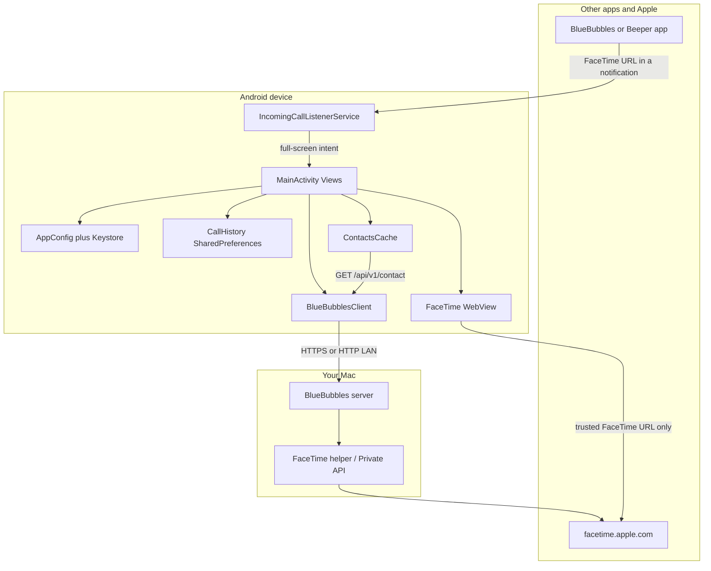
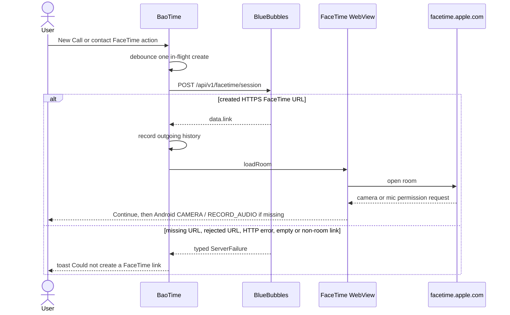
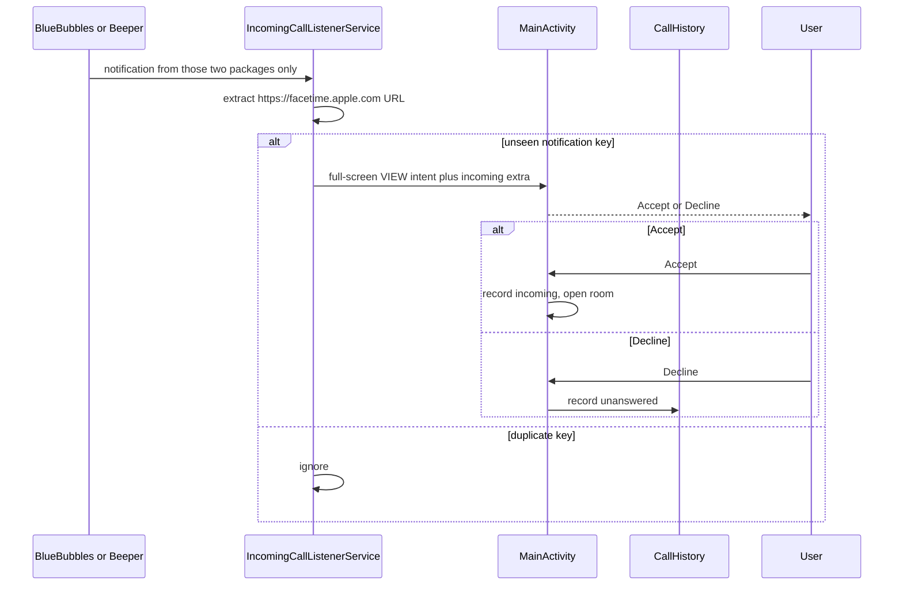
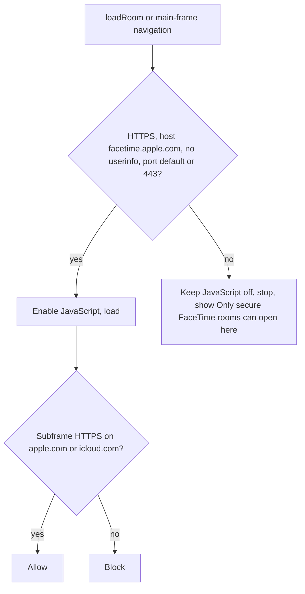

# BaoTime

[](#build)
[](#requirements)
[](#requirements)
[](#build)
[](#build)
[](#repository-layout)
[](#limitations)

<p align="center">
  
</p>

## ELI5

BaoTime is an Android phone app that talks to **your** Mac.

Apple FaceTime still happens on Apple's website. The Mac runs a [BlueBubbles](https://bluebubbles.app/) server. BaoTime asks that server for a FaceTime **web link**, then opens that link in a locked-down in-app browser so you can join the room. Incoming FaceTime links that appear in BlueBubbles or Beeper notifications can raise a full-screen Accept / Decline screen instead of leaving you in a browser tab.

It is **not** Apple FaceTime, **not** an iMessage client, and **not** a replacement for the system Phone app. Cellular dialing is handed to the stock dialer.

## Contents

- [What it is](#what-it-is)
- [Features](#features)
- [Architecture](#architecture)
- [Call flows](#call-flows)
- [Requirements](#requirements)
- [First-run setup](#first-run-setup)
- [Build](#build)
- [Tests](#tests)
- [Icons and design audit](#icons-and-design-audit)
- [Repository layout](#repository-layout)
- [Security and data](#security-and-data)
- [Limitations](#limitations)

## What it is

BaoTime (`com.baotime.app`, version **1.1.0** / `versionCode` 2) is a single-module Android app written in Kotlin with the Android View system (no Jetpack Compose, no Material Components library). `MainActivity` owns Recents, Contacts, Settings sheets, incoming invitations, and one FaceTime room at a time.

The Mac side is out of this tree. BaoTime is the Android client: it stores your BlueBubbles base URL and password, calls three HTTP APIs, opens `https://facetime.apple.com/...` rooms, and cooperates with BlueBubbles / Beeper notifications plus Android's link and dial intents.

This GitHub repository is **private**. There is **no license file** and **no GitHub Actions workflow**. Badges above are static shields, not CI status.

## Features

Grounded in `app/src/main` (manifest, strings, and Kotlin). Things the app does **not** do are listed under [Limitations](#limitations).

### Recents

- Newest-first history of FaceTime links BaoTime opened, received, or declined.
- Row action joins a stored link, or creates a new one when no URL is stored.
- Opening a row shows copy, share, join, and delete.
- Header action clears all history after a confirmation sheet.
- Unanswered invitations increment a Recents tab badge.
- UI shows up to **40** rows; the store keeps at most **100**.

### Contacts

- Search across favorites, iMessage contacts from the Mac (`GET /api/v1/contact`), and this device's address book.
- Mac contacts skip addresses already present on the device.
- Contact sheet: create a FaceTime link, dial a phone number with the system Phone app (not for email/Apple ID), add or remove a favorite.
- Denied device-contacts access sends you to app settings (there is **no** in-app runtime `READ_CONTACTS` dialog).
- First 30 rows per section, then "Show All".

### New Call

- Sheet for a phone number, Apple ID / email, or a whole `https://facetime.apple.com/...` URL.
- Whole FaceTime URL → join that room. Anything else → ask BlueBubbles to mint a new session, then open it.
- Matching contacts appear under the field as you type.

### FaceTime room

- One WebView overlay. JavaScript is **off** until the URL is a canonical HTTPS FaceTime room (`facetime.apple.com`, no userinfo, port 443 or default).
- Main-frame navigation must stay on those rooms. Subframes must be HTTPS on `apple.com` / `icloud.com` hosts (lookalikes rejected).
- Camera and microphone: Apple's page requests them; BaoTime shows **Continue** only after that, then asks Android for `CAMERA` / `RECORD_AUDIO` if needed. Declining an incoming invitation never starts media.
- Picture-in-picture (9:16). Auto-enter on Android 12+ only while this overlay is the top surface and resumed.
- Room menu: share the link, speaker (Android 12+ communication device), PiP, reload. Closing the overlay records elapsed session time.

### Incoming invitations

- `NotificationListenerService` watches **BlueBubbles** (`com.bluebubbles.messaging`) and **Beeper** (`com.beeper.android`) only.
- If notification text contains a FaceTime URL, BaoTime posts a high-importance call notification with a full-screen intent.
- Accept opens the room. Decline stores an unanswered Recents row. Duplicate notification keys (up to 64) are ignored.

### Settings

- Mac connection: server address + BlueBubbles password. Password is AES/GCM-encrypted in Android Keystore (`v1:` envelope). Save is allowed while the Mac is offline; connectivity is a later status.
- FaceTime Links: whether Android selected BaoTime as the `facetime.apple.com` handler (readable on Android 12+).
- Incoming Invitations: notification listener access plus whether app notifications are enabled.
- Settings gear tints green when `GET /api/v1/server/info` succeeds (version, private API, helper, detected iMessage handle all present).

### System intents

`MainActivity` is `singleTask`, exported, and handles:

| Intent | What BaoTime does |
| --- | --- |
| `https://facetime.apple.com` / `/join` (`autoVerify`) | Join that web room (or show the incoming surface when the extra says it is an incoming call) |
| `facetime:` / `facetime-audio:` | Prefill New Call with the handle |
| `tel:` / `ACTION_DIAL` | Prefill New Call with the number |
| `ACTION_SEND` `text/plain` | Join if the shared text **is** a FaceTime URL; otherwise prefill New Call |

## Architecture



Package map (all under `com.baotime.app`):

| Package | Role |
| --- | --- |
| `config` | SharedPreferences connection + favorites; Keystore password; appearance gates |
| `network` | HTTP client; URL shape policy (no DNS / no "is this LAN?" checks) |
| `routing` | Intent → action; FaceTime URL classification; BlueBubbles paths |
| `data` | History codec; device contacts provider; Mac + device cache |
| `call` | Room session, incoming overlay, notification listener |
| `audio` | Speaker as a communication device (API 31+). Does not set mode or mute |
| `system` | Domain verification + settings jumps |
| `ui` / `ui.theme` / `ui.components` | View chrome, glass blur, sheets, room overlay |

BlueBubbles paths the client actually calls:

| Method | Path | Use |
| --- | --- | --- |
| `GET` | `/api/v1/server/info` | Reachability banner |
| `POST` | `/api/v1/facetime/session` | Mint a FaceTime link (`{}` body) |
| `GET` | `/api/v1/contact` | Mac address book |

The password is sent as a `password` **query parameter** on those URLs (BlueBubbles v1). Timeouts: connect 6s, read 25s.

## Call flows

### Create a link, then join



### Incoming BlueBubbles or Beeper notification



### Room URL gate



## Requirements

### Runtime (the phone)

- Android **10** (API 29) or later. `targetSdk` / `compileSdk` **37**.
- A reachable BlueBubbles server that can mint FaceTime sessions. The in-app copy talks about the FaceTime helper; the optional Xiaomi deployment test also asserts **Private API** and **helper connected**.
- Network. HTTP is allowed (`android:usesCleartextTraffic="true"`) because LAN / `.local` / Tailscale CGNAT URLs are accepted by `ServerUrlPolicy`.
- Optional: BlueBubbles or Beeper installed for incoming notification capture; notification listener + (on API 33+) `POST_NOTIFICATIONS`.
- Optional: `READ_CONTACTS` granted from system settings for on-device names.
- Optional: user-selected default handler for `facetime.apple.com` (Android 12+). This tree has **no** Digital Asset Links file, so Play / domain auto-verify is not something the repo itself completes.

### Build machine

| Piece | What the tree pins |
| --- | --- |
| Gradle | Wrapper **9.9.0** (`gradle/wrapper/gradle-wrapper.properties`) |
| Android Gradle Plugin | **9.6.0-alpha03** (preview) via `gradle/libs.versions.toml` |
| Kotlin | Sources are `.kt`. Catalog key `kotlin = "2.4.21"` is **not referenced** by any plugin or library. `app/build.gradle.kts` applies only `com.android.application` (AGP 9 built-in Kotlin). |
| Java bytecode | Source / target **17** |
| Gradle daemon JVM | `gradle/gradle-daemon-jvm.properties` toolchain **25** |
| Android SDK | Platform **37**, plus a `local.properties` `sdk.dir` (gitignored) |
| `org.gradle.java.home` | [`gradle.properties`](gradle.properties) currently points at a **macOS Android Studio Preview JBR**. That path will not exist on Linux/CI. Override or comment it out on other machines. |

### Optional tooling

- Python 3: [`scripts/audit_design.py`](scripts/audit_design.py) (narrow source / icon provenance checks; not a runtime or Apple certification).
- ImageMagick **7**: [`scripts/render_android_icons.py`](scripts/render_android_icons.py) and [`scripts/render_icon_previews.py`](scripts/render_icon_previews.py).

## First-run setup

1. Install a debug APK (see [Build](#build)).
2. Open **Settings** (gear). Status copy starts as "Checking BlueBubbles Server & FaceTime helper…".
3. **Mac Connection**: base URL (`http://` or `https://`, host required, no `user:pass@` in the URL) and server password. Save. Success copy is "Saved · Connected" or "Saved · Mac unavailable".
4. **FaceTime Links**: open Android's open-by-default settings and choose BaoTime for `facetime.apple.com` if you want those URLs to skip the browser.
5. **Incoming Invitations**: grant notification listener access, then allow app notifications. On API 33+ BaoTime requests `POST_NOTIFICATIONS` after listener access is already on.
6. Optionally grant Contacts in system settings if you want on-device rows and phone-number name lookup.

Server URL policy **intentionally** accepts localhost, RFC1918, Tailscale `100.64.0.0/10`, `.local`, and IPv6. Saving does not ping the server.

## Build

From the repo root, with the Android SDK and a usable JDK:

```bash
./gradlew :app:assembleDebug
```

Other tasks this module defines:

```bash
./gradlew :app:assembleRelease   # minify is off; no signing config in-tree
./gradlew :app:test              # JVM unit tests
./gradlew :app:connectedDebugAndroidTest
```

Release `isMinifyEnabled` is **false**. There is no `signingConfigs` block. `allowBackup` is false; [data extraction rules](app/src/main/res/xml/data_extraction_rules.xml) exclude root/file/database/sharedpref/external for cloud backup and device transfer.

If Gradle refuses to start, check `org.gradle.java.home` in `gradle.properties` before blaming the wrapper.

## Tests

There is **no CI** in this repository. The commands below are what the Gradle module and Python scripts actually expose. They are not a claim that they passed on a given host.

### JVM unit tests (`./gradlew :app:test`)

JUnit 4, plus `org.json` on the JVM:

| Class | What it covers |
| --- | --- |
| [`UrlRouterTest`](app/src/test/java/com/baotime/app/routing/UrlRouterTest.kt) | Extract / whole FaceTime URLs; http rejected; Apple media host lookalikes |
| [`ServerUrlPolicyTest`](app/src/test/java/com/baotime/app/network/ServerUrlPolicyTest.kt) | LAN, loopback, Tailscale, `.local`, IPv6 accepted; userinfo / non-http rejected |
| [`CallHistoryCodecTest`](app/src/test/java/com/baotime/app/data/CallHistoryCodecTest.kt) | Round-trip; corrupt JSON, blank names, bad timestamps / types throw |

### Instrumented tests (`app/src/androidTest`)

Runner: `AndroidJUnitRunner`. Most classes **fail closed** unless you pass instrumentation extras. A default `connectedDebugAndroidTest` with no extras is **not** the intended full suite.

| Gate extra | Classes | Notes |
| --- | --- | --- |
| `auditFixture=true` | `NativeJourneysTest`, `NativeMaterialTest`, `RoomOwnershipTest`, `SurfaceInteractionsTest`, `VisualProfilesTest`, `ContactDirectoryJourneysTest`, `CredentialStoreTest`, `InvitationAndHistoryTest` | Comments say dedicated audit AVD. `CredentialStoreTest` restores SharedPreferences after real Keystore writes. |
| `installationCheck=true` | `InstalledLauncherTest` | Taps the real launcher label **BaoTime**. Uses `AuditEvidence`, so also needs `evidenceRun`. |
| `deploymentCheck=true` | `DeviceConnectionCheckTest` | Asserts manufacturer **Xiaomi**, reads `filesDir/deployment-connection-input.json`, talks to a real Tailscale HTTPS server, writes a receipt. |
| none | `NavigationInsetPaintTest` | Paints call-surface insets LTR/RTL on the UI thread. |

`AuditEvidence` requires `evidenceRun` matching `[a-z0-9-]+` and writes under the app's external files `journeys/<run>/` (gitignored `/evidence/` at repo root is related local output). Example shape:

```bash
./gradlew :app:connectedDebugAndroidTest \
  -Pandroid.testInstrumentationRunnerArguments.auditFixture=true \
  -Pandroid.testInstrumentationRunnerArguments.evidenceRun=local1
```

Do not treat that as a documented supported matrix beyond what the tests themselves assert.

## Icons and design audit

Canonical Icon Composer document: [`assets/BaoTime.icon/`](assets/BaoTime.icon/). Native iOS export receipt: [`assets/native-export-receipt.json`](assets/native-export-receipt.json). Android mipmaps / vector backgrounds are generated and hashed in [`assets/android-icon-export.json`](assets/android-icon-export.json).

```bash
python3 scripts/audit_design.py
python3 scripts/render_icon_previews.py   # needs ImageMagick 7
python3 scripts/render_android_icons.py   # needs ImageMagick 7; rewrites mipmaps
```

The audit script's own footer: it is a **narrow source check**, not runtime, Apple HIG, or "Bao" certification. Icon receipts state Android does **not** run Apple Liquid Glass or native dynamic lighting; previews are static pixels inside the source alpha.

Preview strip (generated, not the live launcher):


Adaptive icon: background gradient + foreground + monochrome (`app/src/main/res/mipmap-anydpi/ic_launcher.xml`), with `mipmap-night-*` dark bitmaps.

## Repository layout

```text
BaoTime/
├── app/                          # sole Android module, namespace com.baotime.app
│   ├── build.gradle.kts
│   └── src/
│       ├── main/                 # manifest, Kotlin, res
│       ├── test/                 # JVM unit tests
│       └── androidTest/          # device / AVD tests
├── assets/                       # Icon Composer source, iOS exports, Android receipts, previews
├── gradle/                       # version catalog, wrapper, daemon JVM 25
├── scripts/                      # design audit + ImageMagick projection
├── build.gradle.kts              # AGP plugin, apply false
├── settings.gradle.kts           # rootProject.name = BaoTime
├── gradle.properties
└── gradle wrapper scripts
```

Libraries actually on the app classpath: AndroidX Core / Activity / Lifecycle KTX, Kotlin coroutines. Tests add JUnit 4, AndroidX Test runner / JUnit / UI Automator, and `org.json` for JVM tests.

UI is DayNight (`Theme.DeviceDefault.DayNight`), tokens in `values/` + `values-night/`. Glass blur is API 31+, off in battery saver and when UI contrast is raised on API 34+. Motion goes through `BaoTimeMotion` and respects animator scale.

## Security and data

- Server password: Android Keystore AES/GCM, `v1:` + Base64. Reads never create keys. Missing vs corrupt vs wrong version stay distinct (`PasswordRead`).
- Connection URL, ciphertext, and a monotonically increasing revision are written in one edit. `ContactsCache` drops in-flight Mac results if the revision moved.
- History JSON in `baotime_call_history`. Favorites in `baotime_config`.
- Backup / device transfer of app data is excluded.
- WebView: no file/content access, mixed content never, JS only on a trusted FaceTime room URL, media permission only for Apple media hosts and only camera/mic resources.
- Manifest `queries` BlueBubbles and Beeper so the listener can see those packages.
- `BLUETOOTH_CONNECT` and `MODIFY_AUDIO_SETTINGS` are **declared** and have **no Kotlin usages**. Speaker routing uses `AudioManager.setCommunicationDevice` on API 31+.

## Limitations

- **Not Apple FaceTime.** Rooms are Apple's web client. Link minting needs a working BlueBubbles FaceTime helper on a Mac you control.
- **No in-tree iOS app.** `assets/` holds Icon Composer / iOS PNG exports used to project the Android launcher.
- **No license, no CI, no releases** in this repository as of the tree this README describes.
- **Private repo.** Shields that would need GitHub API access (stars, workflow status, detected license) are omitted on purpose.
- Catalog `kotlin = "2.4.21"` is unused; do not treat it as a verified compiler version.
- AGP **9.6.0-alpha03** is an alpha. Tooling drift is expected.
- `org.gradle.java.home` is a machine-specific macOS path.
- Password travels as a URL query parameter. Prefer HTTPS; HTTP is allowed for LAN.
- `autoVerify` is set for `facetime.apple.com` but this repo does not ship `assetlinks.json`. Users may have to pick the handler manually.
- Incoming capture only sees BlueBubbles and Beeper notification text. Other apps are ignored.
- Recents is local to the phone, not iCloud / Mac history.
- Speaker control is a no-op below API 31 (`CallAudioRouter.enableSpeaker` returns false).
- Contacts runtime permission is settings-only, not a first-launch dialog.
- `createFaceTimeSession` does not send the callee handle to BlueBubbles; it mints a **link you then share**. The handle is a local label / history key.
- One room at a time (`CallSessionController` closes the previous session).
- Instrumented audit / Xiaomi deployment / launcher tests are environment-specific and argument-gated.
- Design audit does not certify accessibility or on-device contrast.
)
