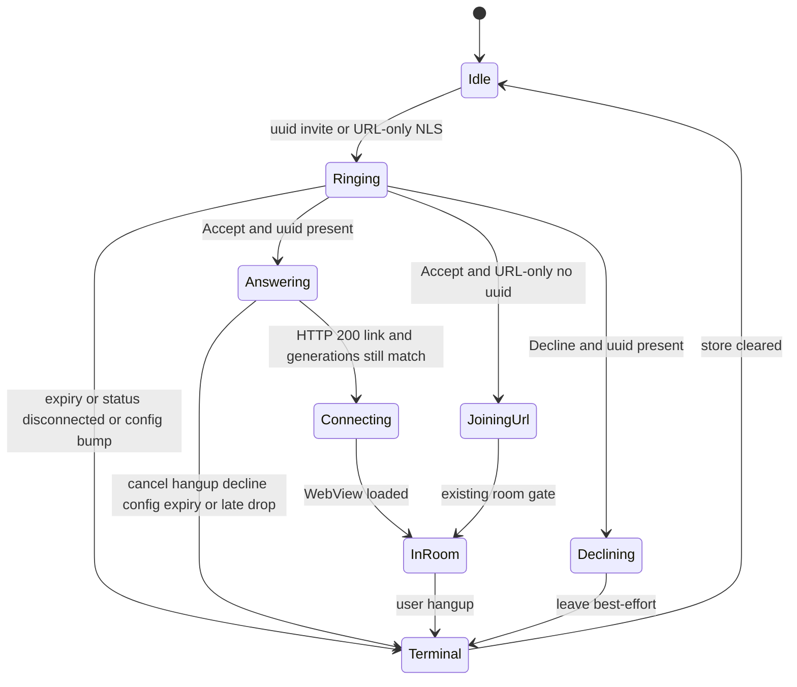

# Implementation Plan: Ingest useful BlueBubbles FaceTime client behaviour into BaoTime

Retrieval date: **2026-11-08**. **Documentation only.** No application code, Gradle, or tests in this change.

Companion docs: [`README.md`](README.md) (index) · [`todo.md`](todo.md) · [`audit-resolution.md`](audit-resolution.md). Repository README: [`../README.md`](../README.md).

## Overview

BaoTime is already a native Kotlin FaceTime-**web** client. It talks to a personal BlueBubbles server (`GET /api/v1/server/info`, `POST /api/v1/facetime/session` with `{}`, `GET /api/v1/contact`) and opens `https://facetime.apple.com` rooms in a gated WebView. Incoming invites today scrape BlueBubbles/Beeper **notification text** for a FaceTime URL.

The official BlueBubbles **Android app is Flutter/Dart**, not a Kotlin app. Native Android is a Kotlin plugin layer around Flutter (FCM, notifications, `SocketIOForegroundService`). It cannot be copied into BaoTime as-is. Useful FaceTime behaviour should be **reimplemented** against documented server REST + Socket.IO APIs.

This is **not** a certified legal clean-room (see [Licence](#licence-obligations-apache-20)). It is an engineering default: do not copy Flutter/Dart or Flutter `MethodChannel` Kotlin.

Do **not** become an iMessage client. Do **not** add unsupported Apple FaceTime native APIs on Android (none exist). Do **not** copy or hook macOS Private API dylibs onto the phone. Do **not** treat Android WebView as Apple-supported FaceTime (Apple names Chrome or Edge).

**Work-package order:** Call lifecycle contract (Task 2) and socket/answer/leave (Tasks 4–7) **precede** any HTTP library swap (Task 12).

## Assumptions and non-goals

### Assumptions

1. Target server remains BlueBubbles **v1.9.12** (`76d2b2e786c04d7516de089f31be978a68da8083`) with FaceTime helper connected and Private API enabled on a Mac the user controls.
2. BaoTime stays a single-module View app (`com.baotime.app`, minSdk 29, target/compileSdk 37).
3. Rooms remain Apple’s web client in the existing WebView gate until Task 13 says otherwise.
4. Server auth stays query `password` / `guid` / `token` (public v1 API). Password stays in Keystore `SecureStore` `v1:`.
5. `AppConfig.connectionRevision` is the config generation to correlate in-flight HTTP and sockets.
6. Killed-app incoming is **not** required for M2 unless a human answers the open question in Task 10.
7. Distribution may be sideload; Google Play FGS/FSI declarations are a **separate** product decision.

### Non-goals

- Native Apple FaceTime / undocumented WebRTC / MITM of Apple.
- Shipping helper dylibs or IMCore hooks on Android.
- iMessage chat, reactions, typing, Find My, backups, Mac lock, server updates from the phone.
- Copying Flutter UI, ObjectBox, GetX, or `MethodChannel` handlers.
- Claiming socket reconnect replays missed call events.
- Claiming FCM after Settings force-stop.
- Claiming `remoteMessaging` or `dataSync` Play eligibility for a FaceTime signaling socket.
- Blocking generic `POST /facetime/session` on callee availability.
- Certified accessibility, HIG, or runtime certification.
- Merging this PR or writing `/Users/brandon/Downloads/facetime_android`.

## Upstream pins (verified 2026-11-08)

| Artifact | Pin | Evidence |
| --- | --- | --- |
| Client repo | https://github.com/BlueBubblesApp/bluebubbles-app Apache-2.0 | GitHub API `license: Apache-2.0`, language **Dart** |
| Latest **Android** client release | **v2.1.5+android.95** (2026-10-29), commit `ff8bfd5a57a8c6686c50d7b7b03d4ef8a5bded11` | GitHub releases |
| Client default HEAD (context) | `master` @ `60113ebababbf23c9faf8fc6746c6691b30d6f69` | GitHub commits API |
| Latest GitHub “latest” client tag | Desktop **v2.1.6+desktop.96** (2026-11-03). Not the Android APK | `gh release list` |
| Server repo | https://github.com/BlueBubblesApp/bluebubbles-server Apache-2.0 | GitHub API |
| Latest **stable** server | **v1.9.12** (2026-10-27), commit `76d2b2e786c04d7516de089f31be978a68da8083` | GitHub releases |
| Helper | https://github.com/BlueBubblesApp/bluebubbles-helper Apache-2.0; tag **0.0.21** (2024-11-19) | GitHub API |
| Socket.IO on server v1.9.12 | `"socket.io": "^4.7.5"` | `packages/server/package.json` @ tag v1.9.12 |
| Socket.IO Java client | **2.1.2** latest on Maven Central (`lastUpdated` 2025-02-18); speaks Engine.IO/Socket.IO 4 | https://repo1.maven.org/maven2/io/socket/socket.io-client/maven-metadata.xml |
| REST docs | https://docs.bluebubbles.app/server/developer-guides/rest-api-and-webhooks | Page footer also “Last updated 3 years ago” — treat Postman + `httpRoutes.ts` as path source of truth |
| Postman | https://documenter.getpostman.com/view/765844/UV5RnfwM | Linked from official REST docs |
| Private API docs | https://docs.bluebubbles.app/private-api | Helper capabilities; **macOS only** |
| Client architecture | https://docs.bluebubbles.app/client/build-yourself-contribution-guide/architecture | Flutter layers, Dart socket, isolates |
| “All clients are Flutter/Dart” | https://docs.bluebubbles.app/client | fetched 2026-11-08 |

**Stable vs alpha (do not mix casually):**

| Piece | Status 2026-11-08 | Use in BaoTime? |
| --- | --- | --- |
| BlueBubbles Server v1.9.12 | **Stable** latest | Target. Gate FaceTime mint/answer/leave on helper + `private_api` + `server_version` from `/api/v1/server/info`. |
| BlueBubbles Android v2.1.5 | **Stable** Android APK | Behaviour reference only |
| Helper 0.0.21 | Last GitHub tag **2024**; server ships dylibs | Mac-side only |
| AndroidX Lifecycle | **Stable 2.11.0**; 2.12.0-alpha05 exists | Stay on **2.11.0** (catalog) |
| Jetpack DataStore | **Stable 1.3.0** | Optional for **non-secrets** |
| `androidx.datastore:datastore-tink` | **Stable 1.3.0** (`maven-metadata.xml` `release` 1.3.0; release notes 2026-10-21 list Encryption Support) | **Do not migrate secrets onto it in FaceTime slices.** Keep Keystore for **migration/scope**, not because tink is prerelease |
| `androidx.security.crypto` EncryptedSharedPreferences | **Deprecated** 1.1.0 | Do **not** migrate onto it |
| OkHttp | **Stable 5.5.1** (Maven `lastUpdated` 2026-10-22) | Task **12**, after lifecycle |
| AGP | BaoTime **9.6.0-alpha03** (alpha). BB Android AGP **9.4.1** | Do not take newer alpha APIs for FaceTime slices |
| Socket.IO Java | **2.1.2** stable | Socket.IO 4 to match server `^4.7.5` |

## Licence obligations (Apache-2.0)

BlueBubbles app, server, and helper are **Apache License 2.0**. LICENSE path `LICENSE` (server blob sha `261eeb9e9f8b2b4b0d119366dda99c6fd7d35c64`). **No NOTICE file** on app @ `ff8bfd5` or server @ `76d2b2e` (GitHub contents API 404).

Apache-2.0 **allows** reproduction and derivative works **if** recipients get the licence, modified files carry change notices, NOTICE contents (if any appear later) are preserved, and patent grant terms are honoured.

BaoTime currently has **no licence file**. That is not a grant to ignore Apache-2.0 if we **copy** BlueBubbles source.

### Reuse vs rewrite (not a legal certification)

| Approach | Engineering default | Legal note |
| --- | --- | --- |
| Copy Flutter/Dart `lib/…` | **Reject.** Not runnable in this Kotlin/View app | Apache-2.0 would still require attribution if copied |
| Copy Kotlin plugins under `android/app/src/main/kotlin/com/bluebubbles/messaging/` | **Avoid.** Tied to Flutter `MethodChannel` | Copy requires BaoTime LICENSE + attribution **before** that slice |
| Extract API paths / event names / JSON field names | **Do this.** Cite sources | Facts; still cite |
| Rewrite Kotlin against public REST/events after reading BB source | **Default engineering approach** | **Not** a certified clean-room. Independent implementation claims need a process this repo has **not** run (separate authors, no source access, etc.) |
| Vendor helper dylib / IMCore on Android | **Forbidden** | Meaningless and unsafe |
| Apple FaceTime native SDK / WebRTC bypass | **Forbidden** | Does not exist for Android |

**Transitive NOTICE:** adding OkHttp, Socket.IO Java, or FCM later requires recording **those** libraries’ licences (OkHttp Apache-2.0; confirm Socket.IO Java at add time) in Task 14 **before** copy or new third-party code lands. Do not claim “certified clean-room” in README or PRs.

## What the official Android client actually is

- Docs: “All clients are coded in Flutter and Dart.” https://docs.bluebubbles.app/client
- FaceTime HTTP in Dart is **answer** and **leave** only — no session create: [`facetime_api.dart` @ `ff8bfd5`](https://github.com/BlueBubblesApp/bluebubbles-app/blob/ff8bfd5a57a8c6686c50d7b7b03d4ef8a5bded11/lib/services/network/api/facetime_api.dart)
- Outgoing web-link create is server `POST /api/v1/facetime/session` (BaoTime already calls this). Official Flutter client often opens generated links in **Chrome**, not WebView ([issue 2775](https://github.com/BlueBubblesApp/bluebubbles-app/issues/2775))
- Socket (`socket_service.dart` @ `ff8bfd5`): query `guid=<password>`, websocket+polling, `forceNew`. **`incoming-facetime` is subscribed on web/desktop only**; comment: *“FCM handles on Android.”* Android still listens to `ft-call-status-changed`.
- Native: FCM, UnifiedPush, `SocketIOForegroundService` with **`foregroundServiceType="remoteMessaging"`**, minSdk 26, compile/target 36.

BaoTime is the opposite stack: minSdk 29, target 37, View UI, in-app WebView, Keystore password, no Socket.IO, no FCM, no FGS.

## BaoTime current source (this repo)

Inspected 2026-11-08. Production code **unchanged** by this documentation.

| Area | Today | Gap vs official FaceTime path |
| --- | --- | --- |
| HTTP | `HttpURLConnection`, password query, 6s connect / 25s read | No OkHttp, no 401 vs helper-missing, no answer/leave |
| Info | `GET /api/v1/server/info` requires `server_version`, `private_api`, `helper_connected`, `detected_imessage` | Does not **gate** FaceTime on helper/`private_api`. **`facetime_calling` is not in `getServerMetadata()`** |
| Create | `POST /api/v1/facetime/session` `{}` → `data.link` | Matches `FaceTimeRouter.newSession` / `FaceTimeInterface.create()` — **no callee** |
| Contacts | `GET /api/v1/contact` | No `POST /contact/query` |
| Incoming | `NotificationListenerService` scrapes BB/Beeper text for FaceTime URLs; duplicate keys (64) | No `callUuid`; cannot `answer`/`leave`; `IncomingCallController` is Activity-owned; `onDestroy` **disposes** it |
| Room | Gated WebView | Keep as product choice; Apple does not name WebView ([compatibility](#webview-compatibility-risk)) |
| Auth | `SecureStore` AES/GCM Keystore `v1:` | Keep; DataStore-tink is stable but out of scope |
| Config generation | `AppConfig.connectionRevision` already invalidates in-flight **contacts** | Must also invalidate socket + in-flight answer/leave |
| Background | None | Incoming dies unless NLS still sees a notification |
| Tests | JVM router/policy/codec; gated instrumented | No socket/FCM tests |

## Public REST vs Private API vs Apple

Auth on almost all REST: query `guid` **or** `password` **or** `token` = server password. Official: https://docs.bluebubbles.app/server/developer-guides/rest-api-and-webhooks

`HttpRoutes.protected` = AuthMiddleware. `PrivateApiMiddleware` = `checkPrivateApiStatus()`.

https://github.com/BlueBubblesApp/bluebubbles-server/blob/76d2b2e786c04d7516de089f31be978a68da8083/packages/server/src/server/api/http/api/v1/httpRoutes.ts

### FaceTime REST (group middleware: protected **+ Private API**; macOS Monterey+ in code)

Router: https://github.com/BlueBubblesApp/bluebubbles-server/blob/76d2b2e786c04d7516de089f31be978a68da8083/packages/server/src/server/api/http/api/v1/routers/facetimeRouter.ts  
Interface: https://github.com/BlueBubblesApp/bluebubbles-server/blob/76d2b2e786c04d7516de089f31be978a68da8083/packages/server/src/server/api/interfaces/facetimeInterface.ts  
Session: https://github.com/BlueBubblesApp/bluebubbles-server/blob/76d2b2e786c04d7516de089f31be978a68da8083/packages/server/src/server/api/lib/facetime/FaceTimeSession.ts

`isMinMonterey` is the gate. The `create()` error string still says “Big Sur”; **trust the check, not the string**.

| Method | Path | Private API | What it does | BaoTime |
| --- | --- | --- | --- | --- |
| POST | `/api/v1/facetime/session` | **yes** | `FaceTimeInterface.create()` → `fromGeneratedLink(null)` → `admitAndLeave`. **No callee in body** | **Have** |
| POST | `/api/v1/facetime/answer/:call_uuid` | **yes** | Answer, generate link, admitAndLeave; `{ data: { link } }` | **Missing** |
| POST | `/api/v1/facetime/leave/:call_uuid` | **yes** | Private API `leaveCall` | **Missing** |

Server session objects invalidate after **3 hours**. Incoming **UI** must not wait that long (BB Android notification `setTimeoutAfter(30000)`).

### Related REST

| Method | Path | Notes |
| --- | --- | --- |
| GET | `/api/v1/ping` | Auth; BB uses HTTP 401 as bad password |
| GET | `/api/v1/server/info` | Version, `private_api`, helper, detected handle. **No `facetime_calling`** ([`generalInterface.ts` `@ 76d2b2e`](https://github.com/BlueBubblesApp/bluebubbles-server/blob/76d2b2e786c04d7516de089f31be978a68da8083/packages/server/src/server/api/interfaces/generalInterface.ts)) |
| GET | `/api/v1/contact` | Have |
| GET | `/api/v1/handle/availability/facetime?address=` | Route has **no** extra `PrivateApiMiddleware`; **implementation** still `checkPrivateApiStatus()` ([`handleInterface.ts`](https://github.com/BlueBubblesApp/bluebubbles-server/blob/76d2b2e786c04d7516de089f31be978a68da8083/packages/server/src/server/api/interfaces/handleInterface.ts)) |

### Socket events

https://github.com/BlueBubblesApp/bluebubbles-server/blob/76d2b2e786c04d7516de089f31be978a68da8083/packages/server/src/server/events.ts  
Handler: https://github.com/BlueBubblesApp/bluebubbles-server/blob/76d2b2e786c04d7516de089f31be978a68da8083/packages/server/src/server/api/privateApi/eventHandlers/PrivateApiFaceTimeStatusHandler.ts  
Flutter mapping: [`action_handler.dart` @ `ff8bfd5`](https://github.com/BlueBubblesApp/bluebubbles-app/blob/ff8bfd5a57a8c6686c50d7b7b03d4ef8a5bded11/lib/services/backend/action_handler.dart)

Server config `facetime_calling` chooses the emit path. It is **not** in `/server/info`. BaoTime must listen to **both**:

| Event | When | Payload | Can REST-answer? |
| --- | --- | --- | --- |
| `ft-call-status-changed` | `facetime_calling` true | `{ uuid, status, status_id, address, handle, is_audio, is_video, … }` (`uuid` aliased from `call_uuid`). Incoming = `status_id` **4**; disconnected = **6** | **Yes**, if `uuid` present |
| `incoming-facetime` | `facetime_calling` false (legacy). Flutter: “legacy incoming FaceTime” | JSON **string** `{ caller, timestamp }` — **no uuid** | **No**. Fail-safe: UI-only or ignore; NLS URL path may still join a link |

Handshake: query `guid=<server password>`, websocket+polling, Socket.IO 4.

`emitMessage` (server `index.ts`): `socketServer.emit` + optional FCM + webhook. **No per-socket replay buffer.**

### Not proposed

Native Apple FaceTime on Android; MITM; helper bundles; full chat; copying Flutter; FGS type claimed eligible without Task 10.

## Call lifecycle contract

Authoritative for Tasks 4–7. Implementation is future; this is the spec those tasks must not violate.

### Identity

Every invite/session is keyed by:

| Field | Source | Role |
| --- | --- | --- |
| `callUuid` | `ft-call-status-changed.uuid` (preferred). Null for legacy `incoming-facetime` and for NLS URL-only | REST answer/leave; status correlation |
| `faceTimeUrl` | NLS extract or answer `data.link` | WebView join; NLS dedup |
| `configGeneration` | `AppConfig.connectionRevision` at invite start | Drop work after Settings save |
| `inviteGeneration` | Process-monotonic counter | Cancel in-flight HTTP; ignore late responses |
| `source` | `SocketCalling` / `SocketLegacy` / `NlsUrl` / `Fcm` (Fcm only if Task 11) | Dedup + capability |

**Same-uuid duplicates vs cross-source correlation are different rules.**

| Kind | When it applies | Behaviour |
| --- | --- | --- |
| Same-uuid duplicate | Two events both carry the **same non-null** `callUuid` (socket retry, second `ft-call-status-changed`, FCM payload that includes that uuid) | **One** invite / one overlay |
| Intra-source URL key | Two NLS notifications with the same FaceTime URL (today’s `IncomingCallController` / listener `seenKeys`) | One NLS invite |
| Intra-source weak key | Two **legacy** `incoming-facetime` `{ caller, timestamp }` events only | Optional collapse inside that source |
| Cross-source (NLS URL-only ↔ socket uuid) | NLS has a room **URL** and no uuid. Calling-mode socket has **uuid + address**, **no room URL** | **Not the same identity.** Do **not** join them |

The UUID → URL → weak-key fallback is **only** how to pick a key **inside one event**. It does **not** prove two events from different sources are the same call.

**Fail-safe matcher guard (authoritative):** NLS URL-only **must not** upgrade or attach a later uuid by time, proximity, or caller-window. A future matcher is allowed only if it uses an **actual shared identifier both events carry**. These two sources do not: [`PrivateApiFaceTimeStatusHandler.ts` `@ 76d2b2e` L85–L101](https://github.com/BlueBubblesApp/bluebubbles-server/blob/76d2b2e786c04d7516de089f31be978a68da8083/packages/server/src/server/api/privateApi/eventHandlers/PrivateApiFaceTimeStatusHandler.ts#L85-L101) (`uuid`, `address`, status — no `url`); BaoTime NLS is URL-only (`IncomingCallController` 24–54). Prefer uuid for REST answer. Keep the NLS URL invite separate.

**Unrelated uuid while an NLS invitation is displayed:** treat as a **different** invite. Do not merge, do not copy the uuid onto the NLS row, do not `POST /answer/{uuid}` or `/leave/{uuid}` for that URL. One-overlay UI (same as today’s different-URL path: if `previous.action.url != action.url` then `decline()` the previous) **replaces** the NLS overlay with the uuid invite; the NLS invite terminates as its **own** missed/declined identity.

### Process vs Activity

| Owner | Lives where | Teardown |
| --- | --- | --- |
| Socket + lifecycle store | **Process** (Application-scoped, not `MainActivity`) | Disconnect on **configGeneration** change or process death — **not** on Activity `onDestroy` |
| Incoming overlay + WebView | Activity | `onDestroy` unbinds UI only; does not answer/leave by itself; does not kill the socket |

Today `MainActivity.onDestroy` calls `incomingCalls.dispose()` and `callSessions.closeSession()`. Future code must not interpret that as “tear down the socket.” `singleTask` + `onNewIntent` must **rebind** UI to the store, not start a second socket.

### States (one incoming uuid at a time unless a later product rule allows barge-in)

Terminal reasons: `Declined`, `Missed`, `Disconnected`, `Expired`, `CancelledByConfig`, `Failed`, `Completed`. Terminal is **idempotent**: further HTTP/socket for that `inviteGeneration` is ignored.

Local ringing expiry: **30s** (BB `CreateIncomingFaceTimeNotification.setTimeoutAfter(30000)`), not the server’s 3-hour session invalidate.

### Required scenario table

| Scenario | Required behaviour |
| --- | --- |
| Wrong-call disconnect | `status_id=6` for uuid **A** does not dismiss/answer uuid **B** |
| Wrong-call answer | Accept only posts `/answer/{activeUuid}`; never a previous uuid |
| Hangup / Decline while answer HTTP pending | Cancel the coroutine/`Call.Factory` call; if the HTTP already succeeded on the Mac, best-effort `/leave/{uuid}`; **do not** open WebView |
| Late HTTP after Decline | `inviteGeneration` mismatch → drop body; no room, no Recents join |
| Late HTTP after config save | `configGeneration` mismatch → drop; reconnect socket with new password/URL |
| Activity recreation | `onNewIntent` / new Activity rebinds to the same store; no second overlay for the same key |
| Process death | Store gone. **Fail-safe:** ringing invite is lost. Socket.IO will not replay it |
| Stale invite | 30s local expiry → `Expired` / missed Recents; optional leave if uuid still known |
| Same-uuid duplicates (socket retry / FCM that carries that uuid) | One overlay; ignore extras. NLS URL-only is **not** a uuid duplicate |
| NLS URL-only vs later socket uuid | **Separate identities** unless a documented matcher uses a shared identifier **both** events actually carry. **No** time/proximity/caller-window upgrade |
| Unrelated uuid while NLS overlay showing | Do not merge. Replace overlay with the uuid invite; NLS ends as its own missed/declined identity (no answer/leave with the new uuid for that URL) |

### Reconnect is not replay

Socket.IO v4 default is **at most once**: a disconnected client does not receive events the server emitted while it was down; the server does not buffer them.

https://socket.io/docs/v4/delivery-guarantees/

BlueBubbles `emitMessage` is a live `socketServer.emit` (plus optional FCM/webhook). There is **no** client offset / missed-event API for FaceTime.

**Supported reconciliation:** status events **while connected**; local expiry; NLS if a URL is visible; optional FCM if Task 11 exists.

**Fail-safe limitation:** after disconnect, missed call events are gone. Do not invent replay. Do not treat reconnect as “catch up.” Settings should not promise otherwise.

### HTTP client

Tasks 4–7 may keep `HttpURLConnection` (or a thin façade). **Do not** swap to OkHttp until Task 12. Cancellation must still be designed (coroutine `Job` + disconnect) so Task 12 does not invent lifecycle.

## Availability is advisory

`FaceTimeRouter.newSession` ignores the request body. `FaceTimeInterface.create()` has no handle argument. BaoTime already mints a **shareable link** and uses the typed handle only as a local label.

`GET /api/v1/handle/availability/facetime?address=` may still fail when the helper is down (`checkPrivateApiStatus()` inside `HandleInterface.getFacetimeAvailability`). That must **not** block generic create. Show an advisory if the route returns `available: false`. Only a **human-approved product rule** may later block create.

Helper/`private_api`/version still gate **whether minting can work at all** (Task 3). That is capability of *this Mac*, not of the callee.

## Foreground service eligibility

Android 14+ requires an FGS type. Retrieved 2026-11-08:

https://developer.android.com/develop/background-work/services/fgs/service-types  
https://developer.android.com/develop/background-work/services/fgs/timeout

| Type | What the docs say | Fits BaoTime call socket? |
| --- | --- | --- |
| `remoteMessaging` | “Transfer **text messages** from one device to another” (continuity when switching devices) | **Not proven.** BB Android uses it for `SocketIOForegroundService` because it is an iMessage client. BaoTime is not that product |
| `dataSync` | Upload/download/backup/import/fetch. Android 15+: **6 hours / 24 hours** then `onTimeout` | **Not** an always-on signaling socket. Timeout makes it unfit |
| `shortService` | ~3 minutes | Unfit for waiting for calls |
| `phoneCall` | Ongoing call via `ConnectionService`; `MANAGE_OWN_CALLS` or `ROLE_DIALER` | BaoTime is **not** the default dialer and does not use Telecom `ConnectionService` today |
| `microphone` / `camera` | Continue capture from background; while-in-use start rules | Only while an **active room** holds media — not for idle invite listening |
| `specialUse` | Play Console explanation required | Possible **if** a human files a policy case; not assumed |

**Default boundary (M2–M3): no FGS.** Socket runs while the process is alive (user recently opened BaoTime). Incoming while the process is dead relies on NLS scrape (URL-only) or a later approved push path.

If Task 10 later chooses FGS, it must name: type, `startForeground` permission, timeout behaviour, full-screen intent policy, and **sideload vs Play**. Until then, **do not pretend eligibility**.

Full-screen intents: BaoTime already declares `USE_FULL_SCREEN_INTENT`. Apps targeting API 34+ are limited to calling/alarms; Play may revoke the default. Check `NotificationManager.canUseFullScreenIntent` in a future implementation; `ACTION_MANAGE_APP_USE_FULL_SCREEN_INTENT` for the settings jump.

https://developer.android.com/about/versions/14/behavior-changes-14 (last updated 2026-10-28)

## Android process states for incoming

Do not collapse these in tests or copy.

| State | Socket (no FGS) | NLS scrape | FCM (if Task 11) |
| --- | --- | --- | --- |
| Foreground | Yes if connected | Yes | Yes |
| Background (Home, another app) | Until process freeze/kill | If BB/Beeper still posts | Typical |
| Swipe away from Recents | Process may die (OEM-dependent) | If listener still bound | Often yes; OEM variance |
| OS process kill (memory) | Dead; **no replay** | If system restarts the listener | Often yes |
| **Force-stop** (Settings) | Dead | Listener stopped | **No delivery until user reopens the app** |
| Reboot | Dead until user opens app (no FGS/BOOT) | After NLS rebound | After FCM registration; still not after a later force-stop |

Force-stop recovery: user launches BaoTime once. Document that as the **accepted limitation**, not as a failed test.

https://firebase.google.com/docs/cloud-messaging/flutter/receive

## Secrets and DataStore

Keep `SecureStore` (Keystore AES/GCM `v1:`):

1. Already implemented and tested (`CredentialStoreTest` under `auditFixture`).
2. Password is a single secret; DataStore-tink would be a **migration** of ciphertext + key alias with no FaceTime feature gain.
3. `EncryptedSharedPreferences` remains deprecated.

`datastore-tink` **1.3.0 is stable**. Do not repeat the stale alpha claim. Optional DataStore 1.3.0 for **non-secrets** (favorites, URL) is still not on the FaceTime critical path.

## WebView compatibility risk

Apple: “Join a FaceTime call from an Android or Windows device” requires the **latest Google Chrome or Microsoft Edge**. Published **2026-05-29**.

https://support.apple.com/en-us/109364

BaoTime’s gated WebView is **not** on that list. Keeping it is a product choice (in-app room, URL gate, PiP). It is **not** proof of Apple-supported compatibility. Official BB often opens Chrome because Flutter WebView was called “terrible” (issue 2775).

Task 13 is a **planned** real-device matrix (admission, camera, mic, navigation, reconnect, PiP). **Not executed** in this documentation PR.

## Latest Android / Kotlin patterns (verified 2026-11-08)

| Topic | Verified pattern | BaoTime action |
| --- | --- | --- |
| Networking | OkHttp **5.5.1** stable | Task **12**, after lifecycle |
| TLS | System trust; LAN HTTP already explicit | No custom trust by default |
| Async | Coroutines; Lifecycle **2.11.0** | Flows; collect in Activity for **UI**; socket in process scope |
| State | `StateFlow` | Connection + invite in the lifecycle store |
| Secrets | Keystore; EncryptedSharedPreferences deprecated; DataStore-tink **stable** but unused | Keep `SecureStore` |
| Background | FGS types + timeouts as above | Foreground-only until Task 10 |
| Observability | Structured logs, no PII | Never log `guid`/`password` query |
| Tests | MockWebServer later; JVM first | No instrumented requirement for Tasks 1–9 |

## Architecture decisions

1. Do not import Flutter modules. Do not claim certified clean-room.
2. Stay a FaceTime-web app.
3. **One CallLifecycle store**; Tasks 4–7 implement it; OkHttp after.
4. Incoming: prefer `ft-call-status-changed` uuid → Accept → `POST /facetime/answer/:uuid` → existing WebView. Legacy `incoming-facetime` cannot answer. NLS URL-only stays join-link fallback.
5. Keep WebView gate; document Apple Chrome/Edge risk.
6. Version/helper gate for mint/answer/leave (Task 3). Availability does not block generic create.
7. NLS stays until socket+answer is proven, then fallback only.
8. No FCM in M2. No FGS in M2.
9. Secrets stay in Keystore for migration/scope.
10. Licence inventory (Task 14) before any BB source copy or new third-party library landing in an implementation PR.

## Feature priority

| P | Feature | Why | Depends |
| --- | --- | --- | --- |
| P0 | Fixtures + lifecycle contract | Auditor HIGH; foundation | — |
| P0 | Helper/Private API/version gate | Fail fast | Fixtures |
| P0 | Process-wide socket + no replay | Real uuid; Activity must not own socket | Lifecycle |
| P0 | Ingress + dedup + answer with cancellation | Completes incoming | Socket |
| P1 | Leave + status + hangup-while-pending | Hygiene | Answer |
| P1 | Availability **advisory** | UX, not a create gate | Gate |
| P2 | Tests/logs | Regression | Answer/leave |
| P2 | OkHttp 5.5.1 | Library hygiene | Lifecycle already in |
| P3 | FGS/push decision | Optional | Human |
| P3 | WebView matrix; licence inventory | Honesty / legal | Human |

## Milestones

**M0 — Contract (these docs).** Human approves slices.

**M1 — Capability + lifecycle store** (Tasks 1–3). Still `HttpURLConnection`. Create-link unchanged except helper gate.

**M2 — Live incoming** (Tasks 4–6) under the lifecycle contract. Foreground/process-alive only.

**M3 — Hygiene** (Tasks 7–9). Leave, advisory availability, tests.

**M4 — Optional** OkHttp (12), background/push (10–11), WebView matrix (13), licence (14).

Each **implementation** milestone (not this docs PR) should leave `:app:test` + `assembleDebug` green. This revision does **not** run those.

## Dependency / acceptance / verification / risks / gates

| Task | Depends on | Acceptance (short) | Verification (when implemented) | Risks / gates |
| --- | --- | --- | --- | --- |
| 1 Fixtures | — | Redacted ping/info + both event shapes | File review vs server sources | Need a real Mac or captured samples |
| 2 Lifecycle contract | 1 | Store + generations + cancellation API specified **and** (in impl) unit-tested without OkHttp | JVM state-machine tests | **Gate:** no socket/OkHttp merge without this |
| 3 Capability gate | 1 | No create/answer HTTP when helper/private_api false | Fixture tests | Do not wait 25s |
| 4 Socket | 2, 3 | Process-wide; config bump reconnects; **reconnect ≠ replay** | Manual connect/401; unit wrapper | Activity `onDestroy` must not disconnect |
| 5 Ingress | 4 | same-uuid collapse; NLS URL-only stays a **separate** identity; no time/proximity upgrade | Parser tests; two-identity case | Unrelated uuid while NLS showing |
| 6 Answer | 2, 5 | Generations match or drop; cancel on hangup | MockWebServer + cancel tests | `admitAndLeave` race remains |
| 7 Leave/status | 6 | Wrong uuid ignored; pending hangup defined | Status enum tests | Best-effort leave |
| 8 Availability | 3 | Advisory only; create still works | Mock true/false/500 | Helper-down 5xx |
| 9 Tests/logs | 6–8 | No password in logs | `:app:test` | — |
| 10 Background design | 7–9 checkpoint | Written type/start/timeout/FSI/distribution **or** foreground-only | Human sign-off | Play policy |
| 11 Push | 10 yes | Process-state matrix; force-stop = limitation | Documented force-stop recovery | GMS / OEM |
| 12 OkHttp | 2 **and** 7 preferred | Façade unchanged; redaction | `:app:test` | **Blocked on Task 2** |
| 13 WebView matrix | — | Planned table filled later | Real devices | Apple Chrome/Edge |
| 14 Licence | before any copy | NOTICE inventory | Diff review | No fake clean-room |

**Hard gates**

1. Task 2 before Tasks 4–7 merge and before Task 12.
2. Task 10 written decision before any FGS/FCM code.
3. Task 14 before copying BB sources or adding third-party libraries in an implementation PR.
4. No Apple native FaceTime.

## Risks and mitigations

| Risk | Impact | Mitigation |
| --- | --- | --- |
| Flutter mistaken for copy-paste Kotlin | High | Do not copy; Task 14 if anyone pastes |
| “Clean-room” overclaim | High | Language in this plan; no certification |
| Private API / helper missing | High | Task 3 |
| `admitAndLeave` race | High | Known ([helper#38](https://github.com/BlueBubblesApp/bluebubbles-helper/issues/38), [server#601](https://github.com/BlueBubblesApp/bluebubbles-server/issues/601)). Open link immediately after answer; no Apple-side hacks |
| Socket reconnect expected to replay | High | Explicit limitation; NLS/FCM only other paths |
| `remoteMessaging` Play rejection | Med | Do not ship that type without Task 10 |
| Password in query string | Med | Server-mandated; HTTPS off-LAN; never log URL |
| WebView vs Chrome/Edge | Med | Task 13; do not claim Apple support |
| AGP 9.6 alpha | Med | No extra alpha deps |
| Local Mac `tasks/` conflict | Med | Parent must not overwrite an unrelated plan at `/Users/brandon/Downloads/facetime_android` |

## Open questions (human)

1. Is process-alive incoming enough for M2?
2. Keep Beeper NLS after socket works?
3. Will BaoTime take a licence before any copy?
4. Minimum server: 1.9.12 only, or also 1.9.9?
5. Approve availability as a **create blocker**? Default **no**.
6. Sideload-only vs Play (FGS/FSI declarations)?

## Task list (index)

Full criteria in [`todo.md`](todo.md).

### Phase 1: Contract and capability

- [ ] Task 1: Fixtures (ping, info, both FaceTime event shapes)
- [ ] Task 2: Authoritative CallLifecycle (generations, cancellation, expiry)
- [ ] Task 3: Gate FaceTime on helper / Private API / version

### Checkpoint: Foundation

- [ ] Lifecycle tests; create-link still works when helper is up; **no OkHttp yet**

### Phase 2: Live incoming (existing HTTP client)

- [ ] Task 4: Process-wide Socket.IO 4; reconnect ≠ replay
- [ ] Task 5: Ingress + dedup (`ft-call-status-changed`, legacy, NLS)
- [ ] Task 6: Answer with cancellation → WebView

### Checkpoint: Incoming

- [ ] Foreground uuid-answer works; late/hangup/config cases from Task 2 hold; NLS fallback remains

### Phase 3: Hygiene

- [ ] Task 7: Leave + status; hangup-while-pending
- [ ] Task 8: Availability **advisory**
- [ ] Task 9: Tests and redacted logs

### Phase 4: Optional / honesty

- [ ] Task 10: Background/FGS/FSI written decision
- [ ] Task 11: FCM/UnifiedPush only if 10 says so (force-stop limitation)
- [ ] Task 12: OkHttp 5.5.1 (**after** Task 2)
- [ ] Task 13: WebView compatibility matrix (planned)
- [ ] Task 14: Licence/NOTICE inventory before copy

## What this revision verified

| Check | This revision |
| --- | --- |
| App assemble / `:app:test` / instrumented | **Not run** (documentation-only request) |
| Markdown anchors in new `tasks/` files | To be checked statically after write |
| Mermaid in this file | Static parse only (planned) |
| Authenticated GitHub README blob / Mermaid | **UNVERIFIED** |
| GitHub repo description / topics | **Set.** Live API 2026-11-08: `private: true`, `homepage: null`, description and lowercase topics as in root README Verification. **Desktop CLI registration still unverified.** This agent did not change repo settings |
| Accessibility / runtime / Apple certification | **None** |
| Upstream pins, router, events, FGS docs, DataStore maven, Socket.IO delivery, Apple 109364, FCM force-quit | Fetched **2026-11-08** |

Prior README badge/Mermaid Chrome preview (unauthenticated shields + local mermaid) is **not** github.com authenticated rendering.

## Local transfer note

This agent **cannot** write `/Users/brandon/Downloads/facetime_android`. Copies also live under `/opt/cursor/artifacts/tasks/`. Parent copies `tasks/*.md` only. **Do not** overwrite that folder’s README. **Do not** copy if that folder already has an **unchecked** plan for other work — resolve the conflict first.
